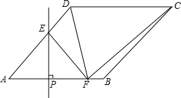

# Mathematics - 题目 3991

**ID**: 78a8d59af51745a7aad78e72c58f5e53
**年级**: Grade 9
**难度**: Medium-Hard
**题型**: Fill-in-the-blank

## 题目
如图，在菱形ABCD中，∠DAB=45°，AB=4，点P为线段AB上一动点，过点P作PE⊥AB交直线AD于点E，将∠A沿PE折叠，点A落在F处，连接DF，CF，当△CDF为直角三角形时，线段AP的长为．​​​​​​​‌

## 解答

1. 分两种情况讨论：①如图1，当DF⊥AB时，△CDF是直角三角形．
2. 
3. ∵在菱形ABCD中，AB=4，∴CD=AD=AB=4．
4. 在Rt△ADF中，∵AD=4，∠DAB=45，DF=AF=2 $\sqrt {2}$ ，∴AP$=\frac {1}{2}$AF$=\sqrt {2}$ ．
5. ②如图2，当CF⊥AB时，△DCF是直角三角形．
6. 
7. 在Rt△CBF中，∵∠CFB=90°，∠CBF=∠A=45°，BC=4，∴BF=CF=2 $\sqrt {2}$ ，∴AF=4+2 $\sqrt {2}$ ，∴AP$=\frac {1}{2}$AF=2 $+\sqrt {2}$ ．
8. 综上所述：线段AP的长为 $\sqrt {2}$ 或2 $+\sqrt {2}$ ．
9. 故答案为 $\sqrt {2}$ 或2 $+\sqrt {2}$ ．

## 知识点

**中文**:
  - 菱形的性质

**English**:
  - Properties of Rhombuses

---
