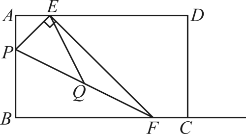

# Mathematics - 题目 3848

**ID**: 7da7d55876064d23b1bc92fca340afda
**年级**: Grade 9
**难度**: Medium-Hard
**题型**: Fill-in-the-blank

## 题目
如图，矩形 $ABCD$ 中， $AB=6$ ， $AD=10$ ，点E在边 $AD$ 上，且 $AE:ED=1:4$ ，动点P从点A出发，沿 $AB$ 运动到点B停止，过点E作 $EF\bot PE$ 交射线 $BC$ 于点F，连接 $PF$ ，点Q是线段 $PF$ 的中点，连接 $EQ$ ，则（1）当 $AP=2$ 时， $BQ=$；​​​​​​​‌（2）连接 $DQ$ ，则在点P运动的整个过程中，线段 $DQ$ 长的最小值为．

## 解答

1. 解：（1）过F作 $FK\bot AD$ 于K，连接 $BQ$ ，
2. 
3. ∵矩形 $ABCD$ 中， $AB=6，AD=10$ ，
4. ∴ $CD=AB=6，BC=AD=10$ ， $\angle A=\angle ABC=\angle BCD=\angle D=90{}\degree $
5. ∴四边形 $ABFK$ 是矩形，
6. ∴ $AK=BF，FK=AB=6$ ．
7. ∵ $AE:ED=1:4$ ，
8. ∴ $AE=2，DE=8$ ．
9. ∵ $AP=2$ ，
10. ∴ $AE=AP，BP=6-2=4$ ，
11. ∴ $\angle APE=\angle AEP=45{}\degree $ ．
12. ∵ $EF\bot PE$ ，
13. ∴ $\angle KEF=45{}\degree =\angle KFE$ ，
14. ∴ $EK=FK=6$ ，
15. ∴ $AK=BF=8$ ，
16. ∴ $PF=\sqrt {BP{^{2}}+BF{^{2}}}=\sqrt {4{^{2}}+8{^{2}}}=4\sqrt {5}$ ．
17. ∵点Q是线段 $PF$ 的中点，
18. ∴ $BQ=\frac {1}{2}PF=2\sqrt {5}$ ．
19. 故答案为： $2\sqrt {5}$ ；
20. （2）如图，连接 $BE，BQ$ ，取 $BE$ 的中点K，连接 $QK$ 并延长与 $DA$ 的延长线交于点J，连接 $JB$ ，
21. 
22. ∵ $\angle ABC=\angle PEF=90{}\degree $ ，点Q是线段 $PF$ 的中点，
23. ∴ $EQ=\frac {1}{2}PF=BQ$ ，
24. ∴Q在 $BE$ 的垂直平分线上，
25. ∴当 $QK$ 为线段 $BE$ 的垂直平分线且 $DQ\bot QK$ 时， $DQ$ 最小，
26. ∴ $JE=JB=AJ+2$ ， $EB/\mskip-4mu/DQ$ ．
27. ∵ $JB{^{2}}=AB{^{2}}+AJ{^{2}}$ ，
28. ∴ ${\left({AJ+2}\right)^{2}}=6{^{2}}+AJ{^{2}}$ ，
29. ∴ $AJ=8$ ，
30. ∴ $JD=AJ+AD=8+10=18$ ．
31. ∵ $EB/\mskip-4mu/DQ$ ，
32. ∴ $\angle BEA=\angle JDQ$ ，
33. ∴ ${\cos}\angle BEA={\cos}\angle QDA=\frac {QD}{JD}$ ．
34. ∵ $AE=2，AB=6，\angle BAD=90{}\degree $ ，
35. ∴ $BE=\sqrt {2{^{2}}+6{^{2}}}=2\sqrt {10}$ ，
36. ∴ ${\cos}\angle BEA=\frac {AE}{BE}=\frac {2}{2\sqrt {10}}=\frac {\sqrt {10}}{10}$ ，
37. ∴ $\frac {QD}{18}=\frac {\sqrt {10}}{10}$ ，
38. ∴ $QD=\frac {9\sqrt {10}}{5}$ ，
39. ∴ $DQ$ 的最小值为 $\frac {9\sqrt {10}}{5}$ ．

## 知识点

**中文**:
  - 矩形的判定与性质综合
  - 解直角三角形
  - 线段垂直平分线的判定与性质

**English**:
  - Determination and Properties of Rectangles
  - Solving Right Triangles
  - Determination and Properties

---
