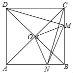

# Mathematics - 题目 1293

**ID**: 7fc2f517212f4c5c835c620630809080
**年级**: Grade 9
**难度**: Medium-Hard
**题型**: Fill-in-the-blank

## 题目
如图，在正方形ABCD中，O是对角线AC与BD的交点，M是BC边上的动点（点M不与B，C重合），CN⊥DM，CN与AB交于点N，连接OM，ON，MN．下列四个结论：①△CNB≌△DMC；​​​​​​​‌②△CON≌△DOM；③△OMN≌△OAD；④AN^{2}+CM^{2}＝MN^{2}；其中正确的结论是．（填写所有正确结论的序号）

## 解答

1. ∵正方形ABCD中，CD＝BC，∠BCD＝90°，
2. ∴∠BCN+∠DCN＝90°，
3. 又∵CN⊥DM，
4. ∴∠CDM+∠DCN＝90°，
5. ∴∠BCN＝∠CDM，
6. 在△CNB和△DMC中， ${\rm\hspace{-0.5em}\begin{array}{l}\rm \begin{cases}∠BCN=∠CDM\\BC=CD\\∠CBN=∠DCM=90{^{\circ }}\end{cases}\end{array}\hspace{-0.5em}}$ ，
7. ∴△CNB≌△DMC（ASA），①正确；
8. ∴CM＝BN，
9. ∵四边形ABCD是正方形，
10. ∴∠OCM＝∠OBN＝45°，OC＝OB＝OD，
11. 在△OCM和△OBN中， ${\rm\hspace{-0.5em}\begin{array}{l}\rm \begin{cases}OC=OB\\∠OCM=∠OBN\\CM=BN\end{cases}\end{array}\hspace{-0.5em}}$ ，
12. ∴△OCM≌△OBN（SAS），
13. ∴OM＝ON，∠COM＝∠BON，
14. ∴∠DOC+∠COM＝∠COB+∠BPN，即∠DOM＝∠CON，
15. 在△CON和△DOM中， ${\rm\hspace{-0.5em}\begin{array}{l}\rm \begin{cases}OC=OD\\∠OCN=∠DOM\\ON=OM\end{cases}\end{array}\hspace{-0.5em}}$ ，
16. ∴△CON≌△DOM（SAS），②正确；
17. ∵∠BON+∠BOM＝∠COM+∠BOM＝90°，
18. ∴∠MON＝90°，即△MON是等腰直角三角形，
19. 又∵△AOD是等腰直角三角形，
20. ∴△OMN∽△OAD，③不正确；
21. ∵AB＝BC，CM＝BN，
22. ∴BM＝AN，
23. ${\rm 又\because Rt\vartriangle BMN中，BM{^{2}}+BN{^{2}}＝MN{^{2}}，}$
24. ${\rm \therefore AN{^{2}}+CM{^{2}}＝MN{^{2}}}$ ,④正确；
25. 故答案为①②④．

## 知识点

**中文**:
  - 正方形的判定与性质综合
  - 相似三角形的判定与性质综合

**English**:
  - Determination and Properties of Squares
  - Determination and Properties

---
