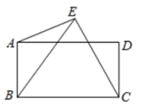

# Mathematics - 题目 1912

**ID**: 81303a0c97324d3fbd63772758972a20
**年级**: Grade 9
**难度**: Medium-Hard
**题型**: Fill-in-the-blank

## 题目
如图，在矩形ABCD中，AB=5，BC=8，在AB的右侧有一点E，且AE=AB，BE=BC，则CE=．​​​​​​​‌

## 解答

1. 解：过点E作EH⊥BC于点H，过点A作AG⊥BE于点G，
2. 
3. ∴∠AGB=∠BHE=90°，
4. ∵AE=AB，BE=BC=8，
5. ∴BG= $\frac {1}{2}$ BE= $\frac {1}{2}$ ×8=4，
6. ∴ ${\rm{A}}{\rm{G}}=\sqrt {{\rm{A}}{\rm{B}}{^{2}}-{\rm{B}}{\rm{G}}{^{2}}}=\sqrt {5{^{2}}-4{^{2}}}=3$ ，
7. ∵矩形ABCD，
8. ∴∠EBH+∠ABG=90°，∠ABG+∠BAG=90°，
9. ∴∠EBH=∠BAG，
10. ∴△ABG∽△BEH，
11. ∴ $\frac {{\rm{A}}{\rm{B}}}{{\rm{E}}{\rm{B}}}=\frac {{\rm{B}}{\rm{G}}}{{\rm{E}}{\rm{H}}}=\frac {{\rm{A}}{\rm{G}}}{{\rm{B}}{\rm{H}}}$ 即 $\frac {5}{8}=\frac {4}{{\rm{E}}{\rm{H}}}=\frac {3}{{\rm{B}}{\rm{H}}}$ ，
12. 解之： ${\rm{E}}{\rm{H}}=\frac {32}{5}，{\rm{B}}{\rm{H}}=\frac {24}{5}$ ，
13. ∴CH=BC-BH= $8-\frac {24}{5}=\frac {16}{5}$ ；
14. 在Rt△CEH中，
15. ${\rm{C}}{\rm{E}}=\sqrt {{\rm{E}}{\rm{H}}{^{2}}+{\rm{C}}{\rm{H}}{^{2}}}=\sqrt {{\left({\frac {32}{5}}\right)^{2}}+{\left({\frac {16}{5}}\right)^{2}}}=\frac {16}{5}\sqrt {5}$ .
16. 故答案为： $\frac {16}{5}\sqrt {5}$ .

## 知识点

**中文**:
  - 三角形的角平分线、中线和高
  - 矩形的性质
  - 相似三角形的判定与性质综合

**English**:
  - Bisectors, Medians, and Altitudes
  - Properties of Rectangles
  - Determination and Properties

---
