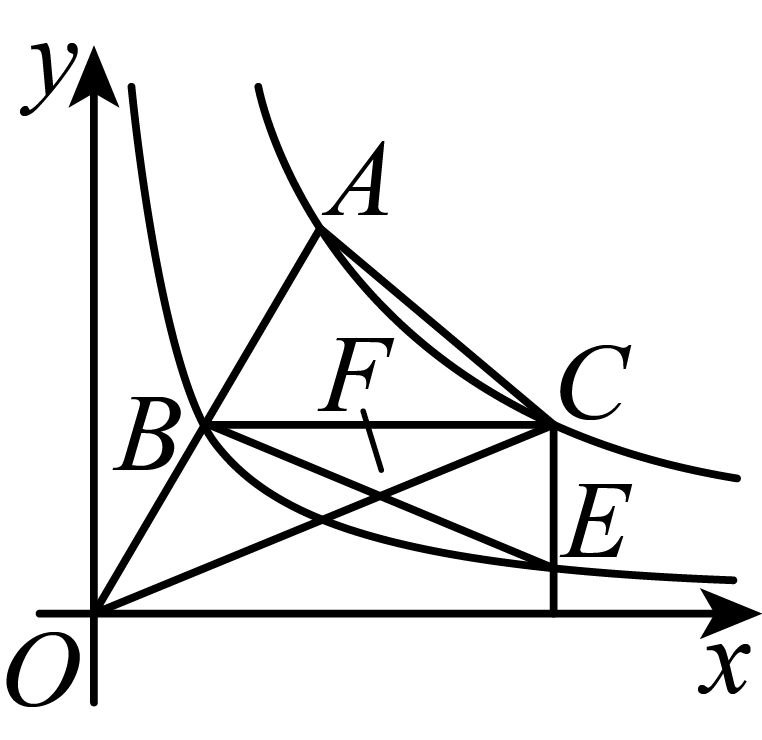

# Mathematics - 题目 3867

**ID**: 85dcdfe2e0864ba1a12f0acd3be1df22
**年级**: Grade 9
**难度**: Medium-Hard
**题型**: Fill-in-the-blank

## 题目
如图，平面直角坐标系中，在反比例函数 $y=\frac {k}{x}(k>0,x>0)$ 的图象上取点A，连接 $OA$ ，与 $y=\frac {k}{4x}$ 的图象交于点B，过点B作 $BC/\mskip-4mu/x$ 轴交函数 $y=\frac {k}{x}$ 的图象于点C，过点C作 $CE\parallel y$ 轴交函数 $y=\frac {k}{4x}$ 的图象于点E，连接 $AC$ ， $OC$ ， $BE$ ， $OC$ 与 $BE$ 交于点F，则 $\frac {S{{}_{△OBF}}}{S{{}_{△AOC}}}=$．​​​​​​​‌

## 解答

1. 解：如图，过点 $A$ 作 $AN\bot x$ 轴于 $N$ ，过点 $B$ 作 $BM\bot x$ 轴于 $M$ ．
2. $∵AN/\mskip-4mu/BM$ ，
3. $\therefore \mathrm{△}OBM∽\mathrm{△}OAN$ ，
4. $\because S{{}_{\vartriangle OBM}}=\frac {k}{8}$ ， $S{{}_{\vartriangle AON}}=\frac {k}{2}$ ，
5. $\therefore $  $\frac {S{{}_{\vartriangle OBM}}}{S{{}_{\vartriangle OAN}}}={\left({\frac {OM}{ON}}\right)^{2}}=\frac {1}{4}$ ，
6. $\therefore $  $\frac {OM}{ON}=\frac {BM}{AN}=\frac {1}{2}$ ，
7. 设 $A\left ({m,\frac {k}{m}}\right )$ ，则 $B\left ({\frac {m}{2},\frac {k}{2m}}\right )$ ，
8. $\because BC\mathrm{/\mskip-4mu/}x$ 轴， $EC/\mskip-4mu/y$ 轴，
9. $\therefore C\left ({2m,\frac {k}{2m}}\right )$ ， $E\left ({2m,\frac {k}{8m}}\right )$ ，
10. 设直线 $OC$ 的解析式为 $y=k{{}_{1}}x$ ，
11. 把 $C\left ({2m,\frac {k}{2m}}\right )$ 代入可得 $\frac {k}{2m}=2mk{{}_{1}}$ ，
12. 解得 $k{{}_{1}}=\frac {k}{4m{^{2}}}$ ，
13. $\therefore $ 直线 $OC$ 的解析式为 $y=\frac {k}{4m{^{2}}}x$ ，
14. 设直线 $BE$ 的解析式为 $y=k{{}_{2}}x+b$ ，
15. 把 $B\left ({\frac {m}{2},\frac {k}{2m}}\right )$ ， $E\left ({2m,\frac {k}{8m}}\right )$ 代入可得，
16. $\begin{cases}\frac {k}{2m}=\frac {m}{2}k{{}_{2}}+b\\\frac {k}{8m}=2mk{{}_{2}}+b\end{cases}$ ，
17. 解得 $\begin{cases}k{{}_{2}}=-\frac {k}{4m{^{2}}}\\b=\frac {5k}{8m}\end{cases}$ ，
18. $\therefore $ 直线 $BE$ 的解析式为 $y=-\frac {k}{4m{^{2}}}x+\frac {5k}{8m}$ ，
19. 由 $\begin{cases}y=\frac {k}{4m{^{2}}}x\\y=-\frac {k}{4m{^{2}}}x+\frac {5k}{8m}\end{cases}$ ，
20. 解得 $\begin{cases}x=\frac {5m}{4}\\y=\frac {5k}{16m}\end{cases}$ ，
21. $\therefore F\left ({\frac {5m}{4},\frac {5k}{16m}}\right )$ ，
22. $\therefore $  $\frac {S{{}_{\vartriangle OBF}}}{S{{}_{\vartriangle AOC}}}=\frac {S{{}_{\vartriangle BOC}}-S{{}_{\vartriangle BFC}}}{S{{}_{\vartriangle BOC}}+S{{}_{\vartriangle BAC}}}=\frac {\frac {1}{2}\left ({2m-\frac {m}{2}}\right )\times \frac {5k}{16m}}{\frac {1}{2}\left ({2m-\frac {m}{2}}\right )\times \frac {k}{m}}=\frac {5}{16}$ .

## 知识点

**中文**:
  - 反比例函数综合
  - 相似三角形的判定与性质综合
  - 待定系数法求一次函数解析式

**English**:
  - Comprehensive Inverse Proportionality Problems
  - Determination and Properties
  - Finding Expressions by Undetermined Coefficients

---
