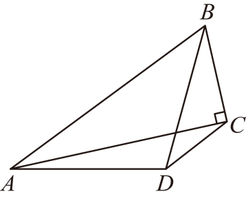

# Mathematics - 题目 3878

**ID**: 8842a3c48c9b4311aa554de947eebfa1
**年级**: Grade 9
**难度**: Medium-Hard
**题型**: Fill-in-the-blank

## 题目
如图，在四边形 $ABCD$ 中， $\angle ACB\mathrm{=}90{}\degree $ ， $AC=\sqrt {3}BC$ ， $AD=4$ ， $CD=2$ ，则当 $BD$ 的长最大时， $\sin \angle CAD$ 的值为．​​​​​​​‌

## 解答

1. 解：过点D在 $AD$ 的上方作 $DE⊥AD$ ，且使 $DE=\frac {\sqrt {3}}{3}AD$ ，连接 $AE$ ， $BE$ ．
2. 
3. ∵ $\frac {AC}{BC}=\frac {AD}{ED}=\sqrt {3}$ ， $\angle ACB=\angle ADE=90{}\degree $ ，
4. ∴ $\vartriangle ADE∽\vartriangle ACB$ ，
5. ∴ $\frac {AB}{AE}=\frac {AC}{AD}$ ， $\angle BAC=\angle EAD$ ，
6. ∴ $\angle BAE+\angle EAC=\angle EAC+\angle CAD$
7. ∴ $\angle BAE=\angle CAD$ ，
8. ∴ $\mathrm{△}ABE\mathrm{∽}\mathrm{△}ACD$ ，
9. ∴ $\frac {BE}{CD}=\frac {AB}{AC}=\frac {2\sqrt {3}}{3}$ ，
10. ∴ $BE=\frac {2\sqrt {3}}{3}CD=\frac {4\sqrt {3}}{3}$ ，
11. ∴点B在以 $\frac {4\sqrt {3}}{3}$ 为半径的 $\odot E$ 上运动（视D为定点，A，C，B为动点），
12. ∴当点B运动到 $DE$ 的延长线与 $\odot E$ 的交点处时， $DB$ 取得最大值．
13. ∵ ${\tan}\angle AED=\frac {AD}{DE}=\sqrt {3}$ ，
14. ∴ $\angle AED=60{}\degree $ ，
15. 当 $DB$ 最大时，  $\angle AEB=120{}\degree $ ．
16. ∵ $\mathrm{△}ABE\mathrm{∽}\mathrm{△}ACD$ ，
17. ∴此时 $\angle ADC=\angle AEB=120{}\degree $ ，
18. 如图，过点C作 $CG\bot AD$ 于点G，则 $\angle CDG=60{}\degree $ ，
19. ∴ $DG=CD\cdot {\cos}60{}\degree =1$ ， $CG=CD\cdot \sin 60{}\degree =\sqrt {3}$ ，
20. ∴ $AG=AD+DG=5$ ，
21. ∴ $AC=\sqrt {CG{^{2}}+AG{^{2}}}=2\sqrt {7}$
22. ∴ $\sin \angle CAD=\frac {CG}{AC}=\frac {\sqrt {3}}{2\sqrt {7}}=\frac {\sqrt {21}}{14}$ ．

## 知识点

**中文**:
  - 点和圆的位置关系
  - 相似三角形的判定与性质综合
  - 解直角三角形

**English**:
  - Point and Circle Relationship
  - Determination and Properties
  - Solving Right Triangles

---
