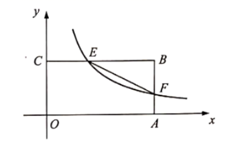

# Mathematics - 题目 1779

**ID**: 89b1717b7ce64057ab151f49cbb3a2a5
**年级**: Grade 9
**难度**: Medium-Hard
**题型**: Fill-in-the-blank

## 题目
如图，平面直角坐标系中， $A(8,0),B(8,4),C(0,4)$ ，反比例函数 $y=\frac {k}{x}$ 在第一象限内的图象分别与线段 $AB、BC$ 交于点 $F、E$ ，连接 $EF$ ，如果点 $B$ 关于 $EF$ 的对称点恰好落在 $OA$ 边上，那么 $k$ 的值为．​​​​​​​‌

## 解答

1. 过点E作EG⊥OA，垂足为G，设点B关于EF的对称点为D，连接DF、ED、BD，如图所示：
2. 
3. 则△BEF≌△DEF，
4. ∴BD=DF，BE=DE，∠FDE=∠FBE=90°，
5. ∴∠EDG+∠ADF=∠ADF+∠AFD，
6. ∴∠EDG=∠AFD，
7. ∵∠EGD=∠DAF，
8. ∴△ADF∽△GED，
9. ∴ $\frac {AD}{EG}=\frac {DF}{DE}$ ，
10. ∴AD：EG=BD：BE，
11. ∵A（8，0），B（8，4），C（0，4），
12. ∴AB=OC=EG=4，OA=BC=8，
13. ∵E、F在反比例函数 $y=\frac {k}{x}$ 的图象上，
14. ∴ $E\left ({\frac {k}{4}，4}\right )、F\left ({8，\frac {k}{8}}\right )$ ，
15. ∴ $OG=EC=\frac {k}{4}$ ， $AF=\frac {k}{8}$ ，
16. ∴ $BF=4-\frac {k}{8}，BE=8-\frac {k}{4}$ ，
17. ∴ $\frac {BF}{BE}=\frac {4-\frac {k}{8}}{8-\frac {k}{4}}=\frac {1}{2}=\frac {DF}{DE}=\frac {AD}{EG}$ ，
18. ∴ $AD=\frac {1}{2}EG=2，$
19. 在Rt△ADF中，由勾股定理：AD^{2}+AF^{2}=DF^{2}
20. 即： $2{^{2}}+{\left({\frac {k}{8}}\right)^{2}}={\left({4-\frac {k}{8}}\right)^{2}}$ ，  解得：k=12，
21. 故答案为12．

## 知识点

**中文**:
  - 公式法解一元二次方程
  - 含30度角的直角三角形
  - 相似三角形的判定与性质综合

**English**:
  - Solving by Quadratic Formula
  - Right Triangle with 30° Angle
  - Determination and Properties

---
