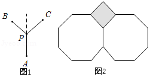

# Mathematics - 题目 1572

**ID**: 8c0c6e687ef043f3bd72f8e0b7169b7e
**年级**: Grade 9
**难度**: Medium-Hard
**题型**: Fill-in-the-blank

## 题目
如图1，作∠BPC平分线的反向延长线PA，现要分别以∠APB，∠APC，∠BPC为内角作正多边形，且边长均为1，将作出的三个正多边形填充不同花纹后成为一个图案．例如，若以∠BPC为内角，可作出一个边长为1的正方形，此时∠BPC=90°，而 $\frac {90{^{0}}}{2}$ =45是360°（多边形外角和）的 $\frac {1}{8}$ ，这样就恰好可作出两个边长均为1的正八边形，填充花纹后得到一个符合要求的图案，如图2所示．图2中的图案外轮廓周长是；​​​​​​​‌在所有符合要求的图案中选一个外轮廓周长最大的定为会标，则会标的外轮廓周长是．

## 解答

1. 图2中的图案外轮廓周长是：8﹣2+2+8﹣2=14；
2. 设∠BPC=2x，
3. ∴以∠BPC为内角的正多边形的边数为： $\frac {360}{180-2x}=\frac {180}{90-x}$ ，
4. 以∠APB为内角的正多边形的边数为： $\frac {360}{x}$ ，
5. ∴图案外轮廓周长是= $\frac {180}{90-x}$ ﹣2+ $\frac {360}{x}$ ﹣2+ $\frac {360}{x}$ ﹣2= $\frac {180}{90-x}$ + $\frac {720}{x}$ ﹣6，
6. 根据题意可知：2x的值只能为60°，90°，120°，144°，
7. 当x越小时，周长越大，
8. ∴当x=30时，周长最大，此时图案定为会标，
9. 则则会标的外轮廓周长是= $\frac {180}{90-30}+\frac {720}{30}$ ﹣6=21，
10. 故答案为14，21．

## 知识点

**中文**:
  - 正多边形的概念和性质

**English**:
  - Regular Polygons Concepts

---
