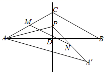

# Mathematics - 题目 1134

**ID**: 8fe74dddeadc471386c012ec23d28c37
**年级**: Grade 9
**难度**: Medium-Hard
**题型**: Fill-in-the-blank

## 题目
在 $\vartriangle ABC$ 中， $AC=BC=4$ ， $\angle ACB=120{}^\circ $ ， $CD\bot AB$ ，点 $P$ 是直线 $CD$ 上一点，连接 $PA$ ，将线段 $PA$ 绕 $P$ 逆时针旋转120°得到 $PA^{′}$ ，点 $M$ 、 $N$ 分别是线段 $AC$ 、 $PA^{′}$ 中点，连接 $MN$ ，则线段 $MN$ 的最小值为．​​​​​​​‌

## 解答

1. 解：点P在直线CD上移动时，点N的轨迹是一条直线，当MN垂直于N_{1}N_{2}时值最小，
2. 如图所示：
3. 
4. 当P和C重合时N_{1}是CB的中点，当PA′和CD重合时，N_{2}是PA′的中点，
5. ∵AC=CB=4，∠ACB=120°，
6. ∴CD⊥AB，CD=2，AD=2 $\sqrt {3}$ ，
7. 则AB=2AD=4 $\sqrt {3}$ ，
8. ∵M、N_{1}分别是AC、BC中点，
9. ∴MN_{1}∥AB，MN_{1}=2 $\sqrt {3}$ ，DE=1
10. ∵PA′是PA绕点P逆时针旋转120°得到的，当PA′和CD重合时，
11. PA′=PA，∠APA′=120°，
12. ∴∠APD=60°，
13. ∴ $AP=\frac {AD}{{\sin}60^\circ }=\frac {2\sqrt {3}}{\frac {\sqrt {3}}{2}}=4$ ，
14. DP=AP•cos60°=4× $\frac {1}{2}$ =2，
15. ∵N_{2}是PA′的中点，
16. ∴PN_{2}=2，EN_{2}=2+2+1=5，
17. ∵MN_{1}∥AB，CD⊥AB，
18. ∴MN_{1}⊥CD，
19. 在△MEN_{2}和△N_{1}EN_{2}中，
20. $\begin{cases}ME=N{{}_{1}}E\\\angle MEN{{}_{2}}=\angle N{{}_{1}}EN{{}_{2}}=90{}^\circ \\EN{{}_{2}}=EN{{}_{2}}\end{cases}$ ，
21. ∴△MEN_{2}≌△N_{1}EN_{2}，
22. N_{2}M=N_{2}N_{1}，
23. 在Rt△MN_{2}E中， $N{{}_{2}}M=\sqrt {ME{^{2}}+EN{{}_{2}^{2}}}=\sqrt {3+25}=2\sqrt {7}$ ，
24. ∴ $S{{}_{ΔMN{{}_{1}}N{{}_{2}}}}=\frac {1}{2}\times MN{{}_{1}}\times EN{{}_{2}}=\frac {1}{2}\times 2\sqrt {3}\times 5=5\sqrt {3}$ ，
25. 又∵ $S{{}_{ΔMN{{}_{1}}N{{}_{2}}}}=\frac {1}{2}\times N{{}_{1}}N{{}_{2}}\times MN=5\sqrt {3},$ ，
26. 即 $\frac {1}{2}\times 2\sqrt {7}\times MN=5\sqrt {3}$ ，
27. ∴ $MN=\frac {5\sqrt {21}}{7}.$ ．
28. 故答案为： $\frac {5\sqrt {21}}{7}$

## 知识点

**中文**:
  - 垂线段最短
  - 旋转的性质

**English**:
  - Shortest Perpendicular Segment
  - Properties of Rotation

---
