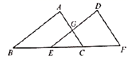

# Mathematics - 题目 776

**ID**: 9002d64910f94d1b8b1b9b2aacffdc43
**年级**: Grade 9
**难度**: Medium-Hard
**题型**: Fill-in-the-blank

## 题目
如图，将 $ΔABC$ 沿 $BC$ 所在的直线平移得到 $ΔDEF$ ，如果 $AB=7$ ， $GC=2$ ， $DF=5$ ，那么 $GE=$．​​​​​​​‌

## 解答

1. 解：∵△ABC沿着射线BC的方向平移得到△DEF，AB=7，
2. ∴DE=7，∠A=∠CGE，∠B=∠DEC，
3. ∴△DEF∽△GEC，
4. ∴ $\frac {EG}{ED}=\frac {GC}{DF}$ ，
5. ∵ $GC=2$ ， $DF=5$ ，
6. ∴ $\frac {EG}{7}=\frac {2}{5}$ ，
7. ∴EG= $\frac {14}{5}$ ，
8. 故填： $\frac {14}{5}$ ．

## 知识点

**中文**:
  - 平移的性质
  - 相似三角形的判定与性质综合

**English**:
  - Properties of Translation
  - Determination and Properties

---
