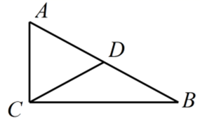

# Mathematics - 题目 1631

**ID**: 9098d2ac34934821a48c1de2fdfc7f2a
**年级**: Grade 9
**难度**: Medium-Hard
**题型**: Fill-in-the-blank

## 题目
在  $\vartriangle ABC$  中， $\angle ACB=90{^{\circ }}$ ， $AB=10$ ，点  $D$  在  $AB$  边上，且  $CD=BD$ ，则  $CD$  =．​​​​​​​‌

## 解答

1. 解：∵ $CD=BD$ ，
2. ∴∠DCB=∠B，
3. 又∵在  $\vartriangle ABC$  中， $\angle ACB=90{^{\circ }}$ ，
4. ∴∠A+∠B=90°，
5. ∠ACD+∠DCB=90°，
6. ∴∠A=∠ACD，
7. ∴CD=AD，
8. ∴CD=AD=BD，
9. ∴CD= $\frac {1}{2}$ AB=5.
10. 故答案为：5.

## 知识点

**中文**:
  - 直角三角形斜边上的中线
  - 等腰三角形的判定与性质
  - 直角三角形的性质

**English**:
  - Median to Hypotenuse of Right Triangle
  - Determination and Properties
  - Properties of Right Triangles

---
