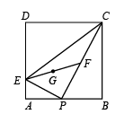

# Mathematics - 题目 2964

**ID**: 91a13dad03a34638aafd39a29e1b3183
**年级**: Grade 9
**难度**: Medium-Hard
**题型**: Fill-in-the-blank

## 题目
如图，正方形ABCD的边长为4，点P在边AB上，PE⊥PC交AD于点E，点F在CP上且PF=PE，G为EF的中点，若点P沿着AB方向移动（不与A重合），则下列结论正确的是．（填序号即可）①∠CEP与∠CPB可能相等；​​​​​​​‌②点G的运动路径是圆弧；③点G到AD、AB的距离相等；④点G到AB的距离的最大值为2．

## 解答

1. 解：①当点P是AB的中点时，∠CEP与∠CPB可能相等，理由如下：
2. ∵四边形ABCD是正方形，且边长为4，
3. ∴∠EAP=∠EPC=∠PBC=90°，AP=PB=2，
4. ∴∠APE+∠CPB=90°，∠PCB+∠CPB=90°，
5. ∴∠APE=∠PCB，
6. ∴Rt△APE∽Rt△BCP，
7. ∴ $\frac {AP}{BC}=\frac {PE}{PC}=\frac {2}{4}=\frac {1}{2}$ ，
8. ∵ $\frac {PB}{BC}=\frac {2}{4}=\frac {1}{2}$ ，
9. ∴ $\frac {PE}{PC}=\frac {PB}{BC}=\frac {1}{2}$ ，又∠EPC=∠PBC=90°，
10. ∴Rt△PCE∽Rt△BCP，
11. ∴∠CEP=∠CPB，
12. ∴∠CEP与∠CPB可能相等，故①正确；
13. ②连接AC，PG，
14. 
15. ∵PE⊥PC，∴∠EPF=90°，
16. ∵PF=PE，∴△EPF是等腰直角三角形，∴∠PEF=45°，
17. ∵G为EF的中点，∴GE=GP=GF，
18. ∴∠EGP=90°，
19. ∵∠DAB=∠EGP=90°，
20. ∴A、E、G、P四点共圆，
21. ∴∠GEP=∠GAP=45°，
22. ∴点G在线段AC上，故②不正确；
23. ③∵AC是正方形ABCD的对角线，即AC是∠DAB的平分线，
24. ∴点G到AD、AB的距离相等；故③正确；
25. ④当点P与点B重合时，点G到AB的距离最大，最大值为2．故④正确；
26. 故此题答案为：①③④．

## 知识点

**中文**:
  - 圆的基本认识
  - 正方形的性质
  - 相似三角形的判定与性质综合
  - 等腰直角三角形的性质

**English**:
  - Basic Concepts of Circles
  - Properties of Squares
  - Determination and Properties
  - Properties of Isosceles Right Triangles

---
