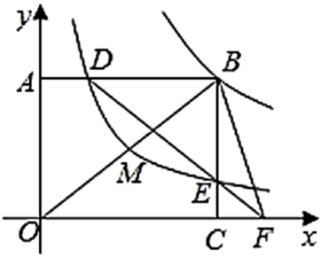

# Mathematics - 题目 3038

**ID**: 92f4e679c11b43c993ad8a0487709f4b
**年级**: Grade 9
**难度**: Medium-Hard
**题型**: Fill-in-the-blank

## 题目
如图，点 $B$ 是反比例函数 $y=\frac {12}{x}(x>0)$ 图象上一点，过点 $B$ 分别向坐标轴作垂线，垂足分别为 $A$ ， $C$ ．反比例函数 $y=\frac {k}{x}(x>0)$ 的图象经过 $OB$ 的中点 $M$ ，与 $AB$ ， $BC$ 分别交于点 $D$ ， $E$ ．连接 $DE$ 并延长交 $x$ 轴于点 $F$ ，则 $\vartriangle BDF$ 的面积是．​​​​​​​‌

## 解答

1. 解：设点B(s,t)，则st=12，
2. ∵M是OB的中点，
3. ∴点M( $\frac {1}{2}$s, $\frac {1}{2}$t)，
4. 则k= $\frac {1}{2}$s$\centerdot $  $\frac {1}{2}$t= $\frac {1}{4}$st=3，
5. 连结OD，如图所示：
6. 
7. ∵BA⊥y轴，
8. ∴BA∥OF，
9. ∴S_{△}_{BDF}=S_{△}_{OBD}=S_{△}_{BOA}-S_{△}_{OAD}= $\frac {1}{2}$ ×12- $\frac {1}{2}$ ×3= $\frac {9}{2}$ ．
10. 故答案为 $\frac {9}{2}$ ．

## 知识点

**中文**:
  - 反比例函数系数k的几何意义及应用

**English**:
  - Geometric Meaning and Application of Coefficient k

---
