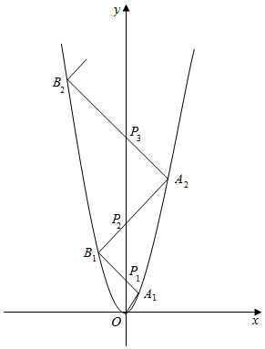

# Mathematics - 题目 224

**ID**: 95aa646d27d94819b2a71b1307d7c34e
**年级**: Grade 9
**难度**: Medium-Hard
**题型**: Fill-in-the-blank

## 题目
如图，抛物线的解析式为 $y=x{^{2}}$ ，点 $A{{}_{1}}$ 的坐标为 $\left ({1,1}\right )$ ，连接 $OA{{}_{1}}$ ：过A_{1}作 $A{{}_{1}}B{{}_{1}}\bot OA{{}_{1}}$ ，分别交y轴、抛物线于点 $P{{}_{1}}$ 、 $B{{}_{1}}$ ：过 $B{{}_{1}}$ 作 $B{{}_{1}}A{{}_{2}}\bot A{{}_{1}}B{{}_{1}}$ ，分别交y轴、抛物线于点 $P{{}_{2}}$ 、 $A{{}_{2}}$ ；​​​​​​​‌过 $A{{}_{2}}$ 作 $A{{}_{2}}B{{}_{2}}\bot B{{}_{1}}A{{}_{2}}$ ，分别交y轴、抛物线于点 $P{{}_{3}}$ 、 $B{{}_{2}}$ …：按照如此规律进行下去，则点 $P{{}_{n}}$ （n为正整数）的坐标是．

## 解答

1. 解：∵点 $A{{}_{1}}$ 的坐标为 $\left ({1,1}\right )$ ，
2. ∴直线 $OA{{}_{1}}$ 的解析式为 $y=x$ ，
3. ∵ $A{{}_{1}}B{{}_{1}}\bot OA{{}_{1}}$ ，
4. ∴ $OP{{}_{1}}=2$ ，
5. ∴ $P{{}_{1}}(0,2)$ ，
6. 设 $A{{}_{1}}P{{}_{1}}$ 的解析式为 $y=kx+b{{}_{1}}$ ，
7. ∴ $\begin{cases}k+b{{}_{1}}=1\\b{{}_{1}}=2\end{cases}$ ，解得 $\begin{cases}k=-1\\b{{}_{1}}=2\end{cases}$ ，
8. 所以直线 $A{{}_{1}}P{{}_{1}}$ 的解析式为 $y=-x+2$ ，
9. 解 $\begin{cases}y=-x+2\\y=x{^{2}}\end{cases}$ ，求得 $B{{}_{1}}(-2，4)$ ，
10. ∵ $B{{}_{1}}P{{}_{2}}/\mskip-4mu/OA{{}_{1}}$ ，
11. 设 $B{{}_{1}}P{{}_{2}}$ 的解析式为 $y=x+b{{}_{2}}$ ，
12. ∴ $-2+b{{}_{2}}=4$ ，
13. ∴ $b{{}_{2}}=6$ ，
14. ∴ $P{{}_{2}}(0，6)$ ，
15. 解 $\begin{cases}y=x+6\\y=x{^{2}}\end{cases}$ 求得 $A{{}_{2}}(3,9)$ ，
16. 设 $A{{}_{2}}P{{}_{3}}$ 的解析式为 $y=-x+b{{}_{3}}$ ，
17. ∴ $-3+b{{}_{3}}=9$ ，
18. ∴ $b{{}_{3}}=12$ ，
19. ∴ $P{{}_{3}}(0,12)$ ，
20. ．．．
21. ∴ $P{{}_{n}}(0，n{^{2}}+n)$ ，
22. 故答案为： $\left ({0,n{^{2}}+n}\right )$ ．

## 知识点

**中文**:
  - y=ax²的图象与性质
  - 待定系数法求一次函数解析式

**English**:
  - Graph and Properties of y=ax²
  - Finding Expressions by Undetermined Coefficients

---
