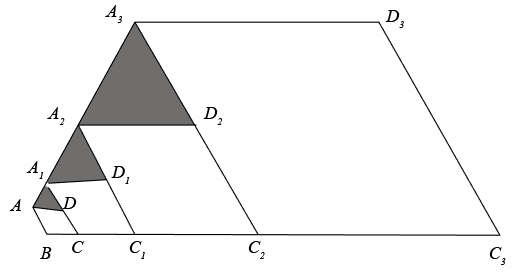

# Mathematics - 题目 3501

**ID**: 95d49e279dd24152a9155438d4639972
**年级**: Grade 9
**难度**: Medium-Hard
**题型**: Fill-in-the-blank

## 题目
如图，菱形 $ABCD$ 中， $\angle ABC=120{}^\circ $ ， $AB=1$ ，延长 $CD$ 至 $A{{}_{1}}$ ，使 $DA{{}_{1}}=CD$ ，以 $A{{}_{1}}C$ 为一边，在 $BC$ 的延长线上作菱形 $A{{}_{1}}CC{{}_{1}}D{{}_{1}}$ ，连接 $AA{{}_{1}}$ ，得到 $ΔADA{{}_{1}}$ ；​​​​​​​‌再延长 $C{{}_{1}}D{{}_{1}}$ 至 $A{{}_{2}}$ ，使 $D{{}_{1}}A{{}_{2}}=C{{}_{1}}D{{}_{1}}$ ，以 $A{{}_{2}}C{{}_{1}}$ 为一边，在 $CC{{}_{1}}$ 的延长线上作菱形 $A{{}_{2}}C{{}_{1}}C{{}_{2}}D{{}_{2}}$ ，连接 $A{{}_{1}}A{{}_{2}}$ ，得到 $\mathrm{Δ}A{{}_{1}}D{{}_{1}}A{{}_{2}}$ ……按此规律，得到 $\mathrm{Δ}A{{}_{2020}}D{{}_{2020}}A{{}_{2021}}$ ，记 $ΔADA{{}_{1}}$ 的面积为 $S{{}_{1}}$ ， $\mathrm{Δ}A{{}_{1}}D{{}_{1}}A{{}_{2}}$ 的面积为 $S{{}_{2}}$ …… $\mathrm{Δ}A{{}_{2020}}D{{}_{2020}}A{{}_{2021}}$ 的面积为 $S{{}_{2021}}$ ，则 $S{{}_{2021}}=$．

## 解答

1. 解：∵四边形 $ABCD$ 是菱形，
2. ∴ $AB=AD=CD=1$ ， $AD{\rm{/}}{\rm{/}}BC,AB{\rm{/}}{\rm{/}}CD$ ，
3. ∵ $\angle ABC=120{}^\circ $ ，
4. ∴ $\angle BCD=60{}^\circ $ ，
5. ∴ $\angle ADA{{}_{1}}=\angle BCD=60{}^\circ $ ，
6. ∵ $DA{{}_{1}}=CD$ ，
7. ∴ $DA{{}_{1}}=AD$ ，
8. ∴ $ΔADA{{}_{1}}$ 为等边三角形，
9. 同理可得 $\mathrm{Δ}A{{}_{1}}D{{}_{1}}A{{}_{2}}$ …….  $\mathrm{Δ}A{{}_{2020}}D{{}_{2020}}A{{}_{2021}}$ 都为等边三角形，
10. 过点B作BE⊥CD于点E，如图所示：
11. 
12. ∴ $BE=BC\cdot {\sin}\angle BCD=\frac {\sqrt {3}}{2}$ ，
13. ∴ $S{{}_{1}}=\frac {1}{2}A{{}_{1}}D\cdot BE=\frac {\sqrt {3}}{4}A{{}_{1}}D{^{2}}=\frac {\sqrt {3}}{4}$ ，
14. 同理可得： $S{{}_{2}}=\frac {\sqrt {3}}{4}A{{}_{2}}D{{}_{1}}{^{2}}=\frac {\sqrt {3}}{4}\times 2{^{2}}=\sqrt {3}$ ， $S{{}_{3}}=\frac {\sqrt {3}}{4}A{{}_{3}}D{{}_{2}}{^{2}}=\frac {\sqrt {3}}{4}\times 4{^{2}}=4\sqrt {3}$ ，……；
15. ∴由此规律可得： $S{{}_{n}}=\sqrt {3}\cdot 2{^{2n-4}}$ ，
16. ∴ $S{{}_{2021}}=\sqrt {3}\times 2{^{2\times 2021-4}}=2{^{4038}}\cdot \sqrt {3}$ ；
17. 故答案为 $2{^{4038}}\cdot \sqrt {3}$ ．

## 知识点

**中文**:
  - 等边三角形的判定与性质
  - 规律型：数与式的变化类
  - 菱形的性质
  - 解直角三角形

**English**:
  - Determination and Properties
  - Patterns: Number and Expression Variations
  - Properties of Rhombuses
  - Solving Right Triangles

---
