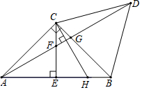

# Mathematics - 题目 380

**ID**: 968e8b417594441391aae608ea283157
**年级**: Grade 9
**难度**: Medium-Hard
**题型**: Fill-in-the-blank

## 题目
如图， $\vartriangle ABC$ 是等腰直角三角形， $∠ACB=90{^{\circ }}$ ，以BC为边向外作等边三角形 ${\rm \mathit{BCD}，}CE\bot AB$ ，连接AD交CE于点F，交BC于点G，过点C作 $CH\bot AD$ 交AB于点H．下列结论： $①CF=CG$ ； $②\vartriangle CFG{\rm ∽}$  $\vartriangle DBG$ ； $③CF=\left ({\sqrt {3}-1}\right )EF$ ； $④{\rm{t}}{\rm{a}}{\rm{n}}∠CDA=2-\sqrt {3}.​​​​​​​‌$ 则正确的结论是$.($ 填序号 $)$

## 解答

1. 解：由题可知,∠CAE=∠ACE=45°,∠BCD=60°,AC=CD=BD=BC,
2. ∴ ${\rm ∠\mathit{ACD}=150°}$ ,
3. ∴ ${\rm ∠\mathit{CDA}=∠\mathit{CAD}=15°}$ ,
4. ∴ ${\rm ∠\mathit{FCG}=∠\mathit{BDG}=45°}$ ,
5. ∴ $\vartriangle CFG\,∽\vartriangle DBG$ , ②正确, ①错误,
6. ∵易证 ${\rm ∠\mathit{FAE}=30°}$ ,设EF=x,则 ${\rm \mathit{AE}=\mathit{CE}=}\sqrt {3}x$ ,
7. ∴ $CF=\left ({\sqrt {3}-1}\right )EF$ , ③正确,
8. 设CH与AD交点为O,易证 ${\rm ∠\mathit{FCO}=30°}$ ,
9. 设OF=y,则CF=2y,由③可知,
10. EF=（ $\sqrt {3}+1$ ）y,
11. ∴AF=（ $2\sqrt {3}+2$ ）y,
12. 在Rt△AOC中, ${{ }}{\rm{t}}{\rm{a}}{\rm{n}}\angle CDA=\frac {OC}{OA}=2-\sqrt {3}$ .
13. 故②③④正确.
14. 

## 知识点

**中文**:
  - 特殊角的三角函数值
  - 相似三角形的判定
  - 解直角三角形

**English**:
  - Trigonometric Values of Special Angles
  - Determination of Similar Triangles
  - Solving Right Triangles

---
