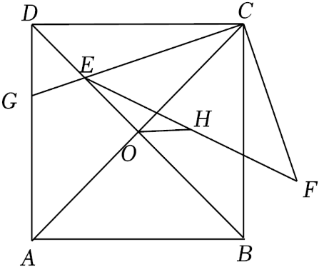

# Mathematics - 题目 3004

**ID**: 9ca17073c9cd4e07bc2054fd9b9b545a
**年级**: Grade 9
**难度**: Medium-Hard
**题型**: Fill-in-the-blank

## 题目
如图，在正方形ABCD中，对角线AC，BD相交于点O，点E是OD的中点，连接CE并延长交AD于点G，将线段CE绕点C逆时针旋转90°得到CF，连接EF，点H为EF的中点．连接OH，则 $\frac {GE}{OH}$ 的值为．​​​​​​​‌

## 解答

1. 解：以O为原点，平行于AB的直线为x轴，建立直角坐标系，过E作EM⊥CD于M，过F作FN⊥DC，交DC延长线于N，如图：
2. 
3. 设正方形ABCD的边长为2，则C（1，1），D（﹣1，1），
4. ∵E为OE中点，
5. ∴E（ $-\frac {1}{2}$ ， $\frac {1}{2}$ ），
6. 设直线CE解析式为y＝kx+b，把C（1，1），E（ $-\frac {1}{2}$ ， $\frac {1}{2}$ ）代入得：
7. $\begin{cases}k+b=1\\-\frac {1}{2}k+b=\frac {1}{2}\end{cases}$ ，
8. 解得 $\begin{cases}k=\frac {1}{3}\\b=\frac {2}{3}\end{cases}$ ，
9. ∴直线CE解析式为 $y=\frac {1}{3}x+\frac {2}{3}$ ，
10. 在 $y=\frac {1}{3}x+\frac {2}{3}$ 中，令x＝﹣1得y＝ $\frac {1}{3}$ ，
11. ∴G（﹣1， $\frac {1}{3}$ ），
12. ∴GE＝ $\sqrt {(-1+\frac {1}{2}){^{2}}+(\frac {1}{3}-\frac {1}{2}){^{2}}}$ ＝ $\frac {\sqrt {10}}{6}$ ，
13. ∵将线段CE绕点C逆时针旋转90°得到CF，
14. ∴CE＝CF，∠ECF＝90°，
15. ∴∠MCE＝90°﹣∠NCF＝∠NFC，
16. ∵∠EMC＝∠CNF＝90°，
17. ∴△EMC≌△CNF（AAS），
18. ∴ME＝CN，CM＝NF，
19. ∵E（ $-\frac {1}{2}$ ， $\frac {1}{2}$ ），C（1，1），
20. ∴ME＝CN＝ $\frac {1}{2}$ ，CM＝NF＝ $\frac {3}{2}$ ，
21. ∴F（ $\frac {3}{2}$ ， $-\frac {1}{2}$ ），
22. ∵H是EF中点，
23. ∴H（ $\frac {1}{2}$ ，0），
24. ∴OH＝ $\frac {1}{2}$ ，
25. ∴ $\frac {GE}{OH}$ ＝ $\frac {\frac {\sqrt {10}}{6}}{\frac {1}{2}}$ ＝ $\frac {\sqrt {10}}{3}$ ．
26. 故答案为： $\frac {\sqrt {10}}{3}$ ．

## 知识点

**中文**:
  - 坐标确定位置
  - 旋转的性质
  - 待定系数法求一次函数解析式

**English**:
  - Position by Coordinates
  - Properties of Rotation
  - Finding Expressions by Undetermined Coefficients

---
