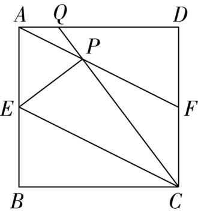

# Mathematics - 题目 1893

**ID**: a53468133baa43c081ce164f37525f23
**年级**: Grade 9
**难度**: Medium-Hard
**题型**: Fill-in-the-blank

## 题目
如图，在正方形纸片 $ABCD$ 中， $E$ 是 $AB$ 边的中点，将正方形纸片沿 $EC$ 折叠，点 $B$ 落在点 $P$ 处，延长 $CP$ 交 $AD$ 于点 $Q$ ，连结 $AP$ 并延长交 $CD$ 于点 $F$ .​​​​​​​‌给出以下结论： $\mathrm{①}△AEP$ 为等腰三角形； $\mathrm{②}F$ 为 $CD$ 的中点； $\mathrm{③}AP:PF=2:3$ ； $\mathrm{④}\cos \mathrm{\angle }DCQ=\frac{3}{4}$ .其中正确结论是（填序号）.

## 解答

1. $\because E$ 是 $AB$ 边的中点， $\therefore EA=EB.\because $  将正方形纸片沿 $EC$ 折叠，点 $B$ 落在点 $P$ 处， $\therefore EB=EP$ ， $\therefore EA=EP$ ， $\therefore △AEP$ 为等腰三角形，故①正确 ${\rm .}\because EA=EP$ ， $\therefore \mathrm{\angle }EAP=\mathrm{\angle }EPA.\because $  将正方形纸片沿 $EC$ 折叠，点 $B$ 落在点 $P$ 处， $\therefore \mathrm{\angle }BEC=\mathrm{\angle }PEC.\because \mathrm{\angle }BEP=\mathrm{\angle }EAP+\mathrm{\angle }EPA$ ， $\therefore \mathrm{\angle }BEC=\mathrm{\angle }EAP.\because $  四边形 $ABCD$ 是正方形， $\therefore \mathrm{\angle }CBE=\mathrm{\angle }ADF$ ， $AB//CD$ ， $BC=AD$ ， $\therefore \mathrm{\angle }EAP=\mathrm{\angle }DFA$ ， $\therefore \mathrm{\angle }BEC=\mathrm{\angle }DFA$ ， $\therefore △BEC≌△DFA(\mathrm{A}.\mathrm{A}.\mathrm{S}.)$ ， $\therefore DF=BE$ ， $\therefore DF=\frac{1}{2}AB=\frac{1}{2}CD$ ，即 $F$ 为 $CD$ 的中点，故②正确.如图，过点 $P$ 作 $PM\perp EC$ 于点 $M$ ，过点 $E$ 作 $EN\perp AF$ 于点 $N.\because \mathrm{\angle }BEC=\mathrm{\angle }EAP$ ， $\therefore EC//AF$ ， $\therefore EN=PM$ .设 $AE=BE=EP=DF=CF=a$ ，则 $BC=AD=PC=2a$ ， $\therefore EC=AF=\sqrt{E{P}^{2}+P{C}^{2}}=\sqrt{{a}^{2}+{\left(2a\right)^{2}}}=\sqrt{5}a.\because {S}_{△PEC}=\frac{1}{2}EC\cdot PM=\frac{1}{2}PE\cdot PC$ ， $\therefore PM=\frac{PE\cdot PC}{EC}=\frac{a\cdot 2a}{\sqrt{5}a}=\frac{2\sqrt{5}a}{5}$ ， $\therefore EN=\frac{2\sqrt{5}a}{5}$ ， $\therefore PN=\sqrt{E{P}^{2}-E{N}^{2}}=\sqrt{{a}^{2}-{\left(\frac{2\sqrt{5}a}{5}\right)^{2}}}=\frac{\sqrt{5}a}{5}$ ， $\therefore AP=2PN=\frac{2\sqrt{5}a}{5}$ ， $PF=AF-AP=\sqrt{5}a-\frac{2\sqrt{5}a}{5}=\frac{3\sqrt{5}a}{5}$ ， $\therefore AP:PF=\frac{2\sqrt{5}a}{5}:\frac{3\sqrt{5}a}{5}=2:3$ ，故③正确 ${\rm .}\because \mathrm{\angle }EAP=\mathrm{\angle }EPA$ ， $\mathrm{\angle }EAD=\mathrm{\angle }EPQ={90}^{\circ }$  ， $\therefore \mathrm{\angle }QAP=\mathrm{\angle }QPA$ ， $\therefore AQ=PQ.\because AD=CD=CP=2a$ ， $\therefore QD=2a-AQ$ ， $CQ=2a+PQ=2a+AQ$ .在 $\mathrm{R}\mathrm{t}△CDQ$ 中，由勾股定理，得 $C{D}^{2}+Q{D}^{2}=C{Q}^{2}$ ，即 ${\left(2a\right)^{2}}+{\left(2a-AQ\right)^{2}}={\left(2a+AQ\right)^{2}}$ ， $\therefore AQ=\frac{1}{2}a$ ， $\therefore CQ=2a+\frac{1}{2}a=\frac{5}{2}a$ ， $\therefore \cos \mathrm{\angle }DCQ=\frac{CD}{CQ}=\frac{2a}{\frac{5}{2}a}=\frac{4}{5}$ ,故④不正确.故答案为①②③.
2. 

## 知识点

**中文**:
  - 三角函数综合
  - 等腰三角形的判定与性质
  - 全等三角形的判定与性质
  - 折叠问题

**English**:
  - Comprehensive Trig Problems
  - Determination and Properties
  - Determination and Properties
  - Folding Problems

---
