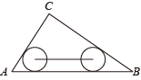

# Mathematics - 题目 1676

**ID**: a67793ee8d764216841689b4f478e4db
**年级**: Grade 9
**难度**: Medium-Hard
**题型**: Fill-in-the-blank

## 题目
如图，在Rt△ABC中，∠ACB＝90°，AC＝6，BC＝8，⊙O与AC、AB都相切，其半径为若在三角线内部沿边AB顺时针方向滚动到与BC相切，则点O运动的路经长是．​​​​​​​‌

## 解答

1. 解：当与AC，AB都相切时，切点分别是P，M，此时，点O在位置，当与BA，BC都相切时，切点分别是N，Q，此时，点O在位置，连接，，，，，作射线交BC于点D，作射线交AC于点E，过点E作于点G，过点D作于点H，如图所示：
2. 
3. 则，
4. 根据切线的性质可得：，，，，
5. ∴，
6. ∴，
7. ∵，
8. ∴四边形是平行四边形，
9. ∴，
10. ∵，，
11. ∴在的角平分线上，在的角平分线上，
12. ∴AD平分，BE平分，
13. ∴，，
14. ∵，
15. ∴，，
16. ∵，，
17. ∴，，
18. 在中，，，，
19. ∴，
20. 设，则，
21. ∵，
22. ，
23. ∴，
24. ∴，即，
25. 解得：，
26. ∴，
27. ∵，
28. ，
29. ∴，
30. ∴，即，
31. ∴，
32. 设，则，
33. ∵，
34. ，
35. ∴，
36. ∴，即，
37. 解得：，
38. ∴，
39. ∵，
40. ，
41. ∴，
42. ∴，即，
43. ∴，
44. ∴，
45. ∴，
46. ∴点O的运动路径长为5，
47. 故答案为：5．
48. 【点睛】题目主要考查圆与三角形综合问题，包括切线的性质，相似三角形的判定和性质，角平分线的判定和性质，勾股定理解三角形，理解题意，作出相应辅助线，综合运用这些知识点是解题关键．

## 知识点

**中文**:
  - 三角形的综合
  - 角平分线的性质
  - 切线的性质定理
  - 相似三角形的判定与性质综合

**English**:
  - Comprehensive Triangle Problems
  - Properties of Angle Bisectors
  - Tangent Properties Theorem
  - Determination and Properties

---
