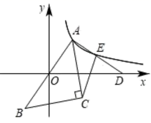

# Mathematics - 题目 2937

**ID**: a6c90f44d2ae4cd096d5f6b4df642ef0
**年级**: Grade 9
**难度**: Medium-Hard
**题型**: Fill-in-the-blank

## 题目
如图，点A与点B关于原点对称，点C在第四象限，∠ACB＝90°，点D是x轴正半轴上一点，AC平分∠BAD，E是AD的中点，反比例函数 $y=\frac {k}{x}$ (k $>$ 0)的图象经过点A，E．若△ACE的面积为6，则k的值为．​​​​​​​‌

## 解答

1. 解：连接OC，在Rt $\vartriangle $ABC中，点O是AB的中点，
2. 
3. ∴OC＝ $\frac {1}{2}$AB＝OA，
4. ∴∠OAC＝∠OCA，
5. ∵AC是∠BAD的角平分线，
6. ∴∠OAC＝∠EAC，
7. ∴∠OCA＝∠EAC，
8. ∴AE∥OC
9. ∴S_{△}_{AEC}＝S_{△}_{AOE}，
10. 过A作AM⊥x轴于M，过E作EN⊥x轴于N，
11. ∵A、E都在反比例函数y＝ $\frac {k}{x}$ 的图象上，
12. ∴S_{△}_{AOM}＝S_{△}_{EON}，
13. ∴S_{梯形}_{AMNE}＝S_{△}_{AOE}，
14. ∵AM∥EN，
15. ∴ $\vartriangle $DAM∽ $\vartriangle $DEN，
16. ∵AE＝DE，S_{梯形}_{AMNE}＝S_{△}_{AOE}＝S_{△}_{AEC}＝6，
17. ∴S_{△}_{AOD}＝12，
18. 延长DA交y轴于P，易得 $\vartriangle $DAM∽ $\vartriangle $DPO，
19. 设EN＝a，则AM＝2a，
20. ∴ON＝ $\frac {k}{a}$ ，OM＝ $\frac {k}{2a}$ ，
21. ∴MN＝ $\frac {k}{2a}$ ，DN＝ $\frac {k}{2a}$ ，
22. ∴DM：OM＝2：1，
23. ∴S_{△}_{DAM}：S_{△}_{AOM}＝2：1，
24. ∴S_{△}_{AOM}＝4，
25. ∴k＝8．
26. 故答案为：8．

## 知识点

**中文**:
  - 反比例函数系数k的几何意义及应用
  - 反比例函数综合
  - 相似三角形的判定与性质综合

**English**:
  - Geometric Meaning and Application of Coefficient k
  - Comprehensive Inverse Proportionality Problems
  - Determination and Properties

---
