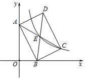

# Mathematics - 题目 3712

**ID**: a9ef2435115a4203b4e773983fb7e18b
**年级**: Grade 9
**难度**: Medium-Hard
**题型**: Fill-in-the-blank

## 题目
如图，矩形ABCD的对角线相交于点E，点A（0，4），点B（2，0），若反比例函数y＝ $\frac {k}{x}$ （x＞0）的图象经过C，E两点，则k的值是．​​​​​​​‌

## 解答

1. 
2. 设点C坐标为（m， $\frac {k}{m}$ ）
3. ∵点E是AC的中点，∴点E坐标为（ $\frac {m}{2},\frac {4+\frac {k}{m}}{2}$ ）
4. 又因为点E在函数 ${\rm{y}}=\frac {k}{x}$ 的图像上，故满足 $\frac {m}{2}\times \frac {4+\frac {k}{m}}{2}$ =k，解得m= $\frac {3}{4}$ k
5. 故点C坐标为（ $\frac {3}{4}$ k， $\frac {4}{3}$ ）
6. 过C作CM⊥x轴交x轴于M，可得△AOB∽△BMC
7. ∴ $\frac {AO}{BM}$ = $\frac {OB}{MC}$ 即 $\frac {4}{\frac {3}{4}k-2}$ = $\frac {2}{\frac {4}{3}}$ 解得k= $\frac {56}{9}$
8. 故k的值是 $\frac {56}{9}$

## 知识点

**中文**:
  - 反比例函数的图象
  - 反比例函数的性质
  - 反比例函数系数k的几何意义及应用
  - 相似三角形的判定与性质综合

**English**:
  - Graph of Inverse Proportionality Functions
  - Properties of Inverse Proportionality Functions
  - Geometric Meaning and Application of Coefficient k
  - Determination and Properties

---
