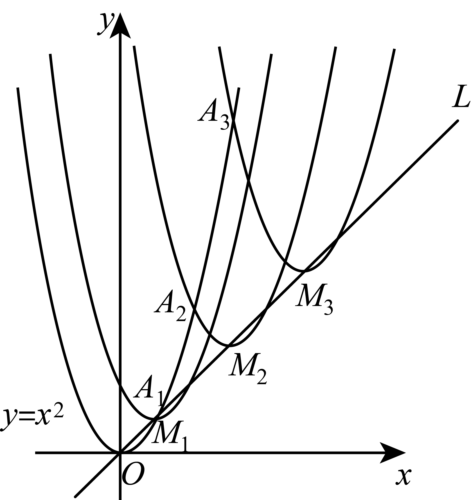

# Mathematics - 题目 3549

**ID**: ab4eadd044e34f939860dd108889931c
**年级**: Grade 9
**难度**: Medium-Hard
**题型**: Fill-in-the-blank

## 题目
如图，抛物线 $y=x{^{2}}$ 在第一象限内经过的整数点（横坐标、纵坐标都为整数的点）依次为 $A{{}_{1}}$ ， $A{{}_{2}}$ ， $A{{}_{3}}$ … $A{{}_{n}}$ ，将抛物线 $y=x{^{2}}$ 沿直线 $L$ ： $y=x$ 向上平移，得到一系列抛物线，且满足下列条件：①抛物线的顶点 $M{{}_{1}}$ ， $M{{}_{2}}$ ， $M{{}_{3}}$ … $M{{}_{n}}$ ，都在直线 $L$ ： $y=x$ 上；​​​​​​​‌②抛物线依次经过点 $A{{}_{1}}$ ， $A{{}_{2}}$ ， $A{{}_{3}}$ … $A{{}_{n}}$ ；则顶点 $M{{}_{2024}}$ 的坐标为．

## 解答

1. 解：设 $M{{}_{1}}\left ({a{{}_{1}},a{{}_{1}}}\right )$ ， $M{{}_{2}}\left ({a{{}_{2}},a{{}_{2}}}\right )$ ， $M{{}_{3}}\left ({a{{}_{3}},a{{}_{3}}}\right )$ ，
2. ∵抛物线 $y=x{^{2}}$ 沿直线 $L$ ： $y=x$ 向上平移，抛物线的顶点 $M{{}_{1}}$ ， $M{{}_{2}}$ ， $M{{}_{3}}$ … $M{{}_{n}}$ ，都在直线 $L$ ： $y=x$ 上，
3. ∴以 $M{{}_{1}}\left ({a{{}_{1}},a{{}_{1}}}\right )$ 为顶点的抛物线为 $y={\left({x-a{{}_{1}}}\right)^{2}}+a{{}_{1}}$ ，
4. ∵ $y={\left({x-a{{}_{1}}}\right)^{2}}+a{{}_{1}}$ 与 $y=x{^{2}}$ 的交点为 $A{{}_{1}}$ ，
5. ∴ ${\left({x-a{{}_{1}}}\right)^{2}}+a{{}_{1}}=x{^{2}}$ ，即 $2a{{}_{1}}x=a{{}_{1}}{^{2}}+a{{}_{1}}$ ，
6. 解得： $x=\frac {1}{2}\left ({a{{}_{1}}+1}\right )$ ，
7. ∵ $A{{}_{1}}$ 为整数点，
8. ∴ $a{{}_{1}}=1$ ， $M{{}_{1}}\left ({1,1}\right )$ ；
9. ∴以 $M{{}_{2}}\left ({a{{}_{2}},a{{}_{2}}}\right )$ 为顶点的抛物线为 $y={\left({x-a{{}_{2}}}\right)^{2}}+a{{}_{2}}$ ，
10. ∵ $y={\left({x-a{{}_{2}}}\right)^{2}}+a{{}_{2}}$ 与 $y=x{^{2}}$ 的交点为 $A{{}_{2}}$ ，
11. ∴ ${\left({x-a{{}_{2}}}\right)^{2}}+a{{}_{2}}=x{^{2}}$ ，即 $2a{{}_{2}}x=a{{}_{2}}{^{2}}+a{{}_{2}}$ ，
12. 解得： $x=\frac {1}{2}\left ({a{{}_{2}}+1}\right )$ ，
13. ∵ $A{{}_{2}}$ 为整数点，
14. ∴ $a{{}_{2}}=3$ ， $M{{}_{2}}\left ({3,3}\right )$ ；
15. ∴以 $M{{}_{3}}\left ({a{{}_{3}},a{{}_{3}}}\right )$ 为顶点的抛物线为 $y={\left({x-a{{}_{3}}}\right)^{2}}+a{{}_{3}}$ ，
16. ∵ $y={\left({x-a{{}_{3}}}\right)^{2}}+a{{}_{3}}$ 与 $y=x{^{2}}$ 的交点为 $A{{}_{3}}$ ，
17. ∴ ${\left({x-a{{}_{3}}}\right)^{2}}+a{{}_{3}}=x{^{2}}$ ，即 $2a{{}_{3}}x=a{{}_{3}}{^{2}}+a{{}_{3}}$ ，
18. 解得： $x=\frac {1}{2}\left ({a{{}_{3}}+1}\right )$ ，
19. ∵ $A{{}_{3}}$ 为整数点，
20. ∴ $a{{}_{3}}=5$ ， $M{{}_{2}}\left ({5,5}\right )$ ；
21. ∴ $M{{}_{n}}\left ({2n-1,2n-1}\right )$ ，
22. ∴ $M{{}_{2021}}\left ({2\times 2024-1,2\times 2024-1}\right )$ ，即 $M{{}_{2021}}\left ({4047,4047}\right )$ .

## 知识点

**中文**:
  - y=ax²的图象与性质
  - 规律型：图形的变化类

**English**:
  - Graph and Properties of y=ax²
  - Patterns: Geometric Variations

---
