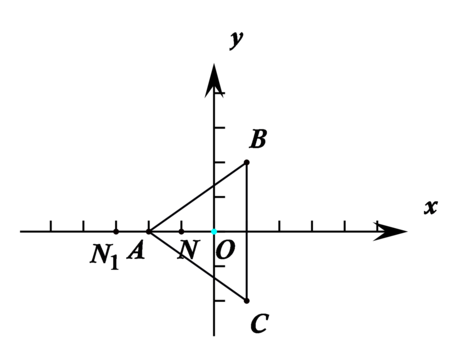

# Mathematics - 题目 1672

**ID**: ac005b62ea224c28b2af2508e7932255
**年级**: Grade 9
**难度**: Medium-Hard
**题型**: Fill-in-the-blank

## 题目
如图，在平面直角坐标系中， $\vartriangle ABC$ 的顶点坐标分别为： $A\left ({-2,0}\right )$ ， $B\left ({1,2}\right )$ ， $C\left ({1,-2}\right )$ ．已知 $N\left ({-1,0}\right )$ ，作点 $N$ 关于点 $A$ 的对称点 $N{{}_{1}}$ ，点 $N{{}_{1}}$ 关于点 $B$ 的对称点 $N{{}_{2}}$ ，点 $N{{}_{2}}$ 关于点 $C$ 的对称点 $N{{}_{3}}$ ，点 $N{{}_{3}}$ 关于点 $A$ 的对称点 $N{{}_{4}}$ ，点 $N{{}_{4}}$ 关于点 $B$ 的对称点 $N{{}_{5}}$ ，…，依此类推，则点 $N{{}_{2020}}$ 的坐标为．​​​​​​​‌

## 解答

1. 解：由题意得，作出如下图形：
2. 
3. N点坐标为(-1,0)，
4. N点关于A点对称的N_{1}点的坐标为(-3,0)，
5. N_{1}点关于B点对称的N_{2}点的坐标为(5,4)，
6. N_{2}点关于C点对称的N_{3}点的坐标为(-3,8)，
7. N_{3}点关于A点对称的N_{4}点的坐标为(-1,8)，
8. N_{4}点关于B点对称的N_{5}点的坐标为(3,-4)，
9. N_{5}点关于C点对称的N_{6}点的坐标为(-1,0)，此时刚好回到最开始的点N处，
10. ∴其每6个点循环一次，
11. ∴ $2020\div 6{\rm{=}}336\cdots \cdots 4$ ，
12. 即循环了336次后余下4，
13. 故 $N{{}_{2020}}$ 的坐标与N_{4}点的坐标相同，其坐标为(-1,8) ．
14. 故答案为：(-1,8) ．

## 知识点

**中文**:
  - 坐标与图形变换——旋转
  - 旋转中的规律性问题
  - 归纳与类比

**English**:
  - Coordinates and Rotation
  - Patterns in Rotation
  - Induction and Analogy

---
