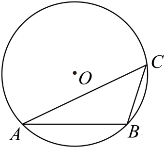

# Mathematics - 题目 3220

**ID**: afbf3e6e4b8c4691ae9c3f0cdf7df396
**年级**: Grade 9
**难度**: Medium-Hard
**题型**: Fill-in-the-blank

## 题目
如图， $\vartriangle ABC$ 是 $\mathrm{⊙}O$ 的内接三角形， $AC>BC$ ， $\angle ACB=45{}\degree $ ，将 $\vartriangle ABC$ 绕点A逆时针旋转后得到 $\vartriangle ADE$ （点B，C的对应点分别为D，E）．当 $AD$ 与 $\mathrm{⊙}O$ 相切时，恰好 $DE$ 所在的直线也与 $\mathrm{⊙}O$ 相切，若 $\mathrm{⊙}O$ 的半径为3，则 $BC$ 的长为．​​​​​​​‌

## 解答

1. 解：设 $DE$ 所在的直线与 $\mathrm{⊙}O$ 的切点为 $F$ ，连接 $FA$ ， $FC$ ， $OF$ ， $OB$ ，连接过 $A$ 的直径 $AN$ ，连接 $FN$ ，连接 $OD$ 交 $FA$ 于 $M$ ，过 $B$ 作 $BG\bot AC$ 于 $G$ ，
2. 
3. ∵ $\angle ACB=45{}\degree $ ， $\mathrm{⊙}O$ 的半径为3，
4. ∴ $OA=OB=OF=3$ ， $\angle AOB=2\angle ACB=90{}\degree $ ，
5. ∴ $AB=\sqrt {OA{^{2}}+OB{^{2}}}=3\sqrt {2}$ ，
6. ∵将 $\vartriangle ABC$ 绕点A逆时针旋转后得到 $\vartriangle ADE$ ，
7. ∴ $\mathrm{△}ABC\mathrm{≌}\mathrm{△}ADE$ ，
8. ∴ $AB=AD=3\sqrt {2}$ ， $∠ADE=∠ABC$ ，
9. ∵ $\angle ADE+\angle ADF=180{}\degree $ ， $\angle ABC+\angle AFC=180{}\degree $ ，
10. ∴ $\angle ADF=\angle AFC$ ，
11. ∵当 $AD$ 与 $\mathrm{⊙}O$ 相切时，恰好 $DE$ 所在的直线也与 $\mathrm{⊙}O$ 相切，
12. ∴ $DF=DA=3\sqrt {2}$ ， $\angle DFO=\angle DAO=90{}\degree $ ， $AF=2FM$ ， $AF\bot OD$ ，
13. ∴ $OD=\sqrt {DF{^{2}}+OF{^{2}}}=3\sqrt {3}$ ，
14. ∵ $S{{}_{\mathrm{△}ODF}}=\frac {1}{2}OF\cdot DF=\frac {1}{2}OD\cdot FM$ ，
15. ∴ $FM=\frac {OF\cdot DF}{OD}=\frac {3\times 3\sqrt {2}}{3\sqrt {3}}=\sqrt {6}$ ，
16. ∴ $AF=2FM=2\sqrt {6}$ ，
17. ∵直径 $AN$ ，
18. ∴ $\angle NFA=90{}\degree $ ，
19. ∴ $\angle N+\angle FAN=90{}\degree $ ，
20. ∵ $\angle DAF+\angle FAN=90{}\degree $ ，
21. ∴ $\angle DAF=\angle N=\angle FCA$ ，
22. ∴ $\mathrm{△}ADF∽\mathrm{△}CFA$ ，
23. ∴ $\frac {AF}{AC}=\frac {DF}{AF}$ ，即 $\frac {2\sqrt {6}}{AC}=\frac {3\sqrt {2}}{2\sqrt {6}}$ ，
24. 解得 $AC=4\sqrt {2}$ ，
25. ∵ $\angle ACB=45{}\degree $ ， $BG\bot AC$ ，
26. ∴ $CG=BG$ ，
27. 设 $CG=BG=x$ ，则 $BC=\sqrt {2}x$ ， $AG=AC-CG=4\sqrt {2}-x$ ，
28. 在 ${\rm{R}}{\rm{t}}\mathrm{△}ABG$ 中， $AG{^{2}}+BG{^{2}}=AB{^{2}}$ ，
29. ∴ ${\left({4\sqrt {2}-x}\right)^{2}}+x{^{2}}={\left({3\sqrt {2}}\right)^{2}}$ ，
30. 解得 $x=2\sqrt {2}\pm 1$ ，
31. 由图可得 $BG<OB$ ，即 $x<3$ ，
32. ∴ $x=2\sqrt {2}-1$ ，
33. ∴ $BC=\sqrt {2}x=4-\sqrt {2}$ .

## 知识点

**中文**:
  - 切线长定理
  - 旋转的性质
  - 相似三角形的判定与性质综合

**English**:
  - Tangent Length Theorem
  - Properties of Rotation
  - Determination and Properties

---
