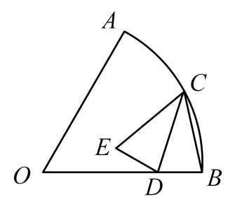

# Mathematics - 题目 2929

**ID**: b17a39c9a2c24192b4940e05d05267cb
**年级**: Grade 9
**难度**: Medium-Hard
**题型**: Fill-in-the-blank

## 题目
如图， $\odot O$ 的半径为 $4$ ， $\overset ⌢{{AB}}$ 所对的圆心角 $\angle AOB=60{}^\circ $ ， $C$ 为 $\overset ⌢{{AB}}$ 的中点， $D$ 为半径 $OB$ 上一动点（点 $D$ 不与点 $B$ 重合）． $\mathrm{△}CDB$ 关于直线 $CD$ 对称的图形为 $\vartriangle CDE$ ，若点 $E$ 落在半径 $OA$ ， $OB$ ， $\overset ⌢{{AB}}$ 围成的封闭图形的边界上，则 $CD$ 的长为．​​​​​​​‌

## 解答

1. 解：点 $E$ 落在半径 $OA$ ， $OB$ ， $\overset ⌢{{AB}}$ 围成的封闭图形的边界上，
2. ①如图所示，点 $E$ 在半径 $OB$ 上，连接 $OC$ ，
3. 
4. ∵ $\mathrm{△}CDB$ 关于直线 $CD$ 对称的图形为 $\vartriangle CDE$ ，
5. ∴ $\angle BDC=\angle EDC=90{}^\circ $ ，
6. ∵ $\angle AOB=60{}^\circ $ ， $C$ 为 $\overset ⌢{{AB}}$ 的中点， $\odot O$ 的半径为 $4$ ，
7. ∴ $\angle COB=30{}^\circ $ ， $OA=OB=OC=4$ ，
8. 在 ${\rm{R}}{\rm{t}}\vartriangle COD$ 中，
9. $CD=OC\centerdot {\sin}30{}^\circ =\frac {1}{2}OC=\frac {1}{2}\times 4=2$ ，
10. $OD=OC\centerdot {\cos}30{}^\circ =\frac {\sqrt {3}}{2}OC=\frac {\sqrt {3}}{2}\times 4=2\sqrt {3}$ ，
11. $BD=OB-OD=4-2\sqrt {3}$
12. ∵ $DE=DB$ ，
13. ∴ $OE=OD-DE=2\sqrt {3}-(4-2\sqrt {3})=4\sqrt {3}-4$ ；
14. ②如图所示，当点 $E$ 落在半径 $OA$ 上，以点 $O$ 为原点，以 $OB$ 所在直线为 $x$ 轴，建立平面直角坐标系，连接 $OC,BE,AC$ ，
15. 
16. 已知 $OA=OB=OC=4$ ，
17. 根据折叠的性质得， $CE=CB$ ，根据点 $C$ 是 $\overset ⌢{{AB}}$ 的中点得， $CA=CB$ ，
18. ∴ $CE=CA=CB$ ，过点 $C$ 作 $CF\bot OA$ 于 $F$ ，
19. ∴ $AF=EF$ ，
20. ∴ $OF=OC\centerdot {\cos}30{}^\circ =4\times \frac {\sqrt {3}}{2}=2\sqrt {3}$ ，则 $AF=OA-OF=4-2\sqrt {3}$ ，
21. ∴ $OE=OD-DE=2\sqrt {3}-(4-2\sqrt {3})=4\sqrt {3}-4$ ，
22. 由①可知， $C\left ({2\sqrt {3},2}\right )$ ，
23. ∴点 $E$ 的横坐标为 $(4\sqrt {3}-4)\centerdot {\cos}60{}^\circ =(4\sqrt {3}-4)\times \frac {1}{2}=2\sqrt {3}-2$ ，
24. 纵坐标为 $(4\sqrt {3}-4)\centerdot {\sin}60{}^\circ =(4\sqrt {3}-4)\times \frac {\sqrt {3}}{2}=6-2\sqrt {3}$ ，
25. ∴ $E(2\sqrt {3}-2,6-2\sqrt {3})$ ，且 $B(4,0)$ ，
26. 设直线 $BE$ 所在直线解析式为 $y=kx+b$ ，
27. ∴ $\begin{cases}(2\sqrt {3}-2)k+b=6-2\sqrt {3}\\4k+b=0\end{cases}$ ，解得 $\begin{cases}k=-1\\b=4\end{cases}$ ，
28. ∴直线 $BE$ 所在直线解析式为 $y=-x+4$ ，
29. ∴ $\angle EBD=45{}^\circ $ ，
30. ∵ $CD\bot BE$ ，
31. ∴ $\angle BDE=2\angle CDB=90{}^\circ $ ，
32. ∵ $E(2\sqrt {3}-2,6-2\sqrt {3})$ ， $C\left ({2\sqrt {3},2}\right )$ ，
33. ∴ $D(2\sqrt {3}-2,0)$ ，
34. 如图所示，过点 $C$ 作 $CH\bot OB$ 于点 $H$ ，则 $H(2\sqrt {3},0)$ ，
35. 
36. 在 ${\rm{R}}{\rm{t}}△CDH$ 中， $CH=2,DH=2$ ，
37. ∴ $CD=\sqrt {DH{^{2}}+CH{^{2}}}=\sqrt {2{^{2}}+2{^{2}}}=2\sqrt {2}$ ；
38. 综上所述， $CD$ 的长为 $2$ 或 $2\sqrt {2}$ ．
39. 故此题答案为 $2$ 或 $2\sqrt {2}$ ．

## 知识点

**中文**:
  - 待定系数法求一次函数解析式
  - 解直角三角形
  - 折叠问题

**English**:
  - Finding Expressions by Undetermined Coefficients
  - Solving Right Triangles
  - Folding Problems

---
