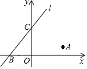

# Mathematics - 题目 1395

**ID**: b519b52b72914773a6725d004c09aa02
**年级**: Grade 9
**难度**: Medium-Hard
**题型**: Fill-in-the-blank

## 题目
如图，在平面直角坐标系中，点 $A$ 的坐标为 $\left ({3,1}\right )$ ，直线 $l$ 与 $x$ 轴， $y$ 轴分别交于点 $B\left ({-3,0}\right )$ ， $C\left ({0,3}\right )$ ，当 $x$ 轴上的动点 $P$ 到直线 $l$ 的距离 $PE$ 与到点 $A$ 的距离 $PA$ 之和最小时，则点 $E$ 的坐标是．​​​​​​​‌

## 解答

1. 如图，过点P作 $PE\bot l$ ，作点A关于x轴的对称点 $A{^{^{′}}}$ ，连接 $PA,PA{^{^{′}}}$
2. 由轴对称的性质得： $PA=PA{^{^{′}}},A{^{^{′}}}(3,-1)$
3. $\therefore OD=3,DA{^{^{′}}}=1$
4. 过点 $A{^{^{′}}}$ 作 $A{^{^{′}}}E{^{^{′}}}\bot l$ ，交x轴于点 $P{^{^{′}}}$
5. 由两点之间线段最短、垂线段最短得： $PE+PA{^{^{′}}}$ 最小值为 $A{^{^{′}}}E{^{^{′}}}$ ，即 $PE+PA$ 最小值为 $A{^{^{′}}}E{^{^{′}}}$ 此时，点P与点 $P{^{^{′}}}$ 重合，点E与点 $E{^{^{′}}}$ 重合，则点 $E{^{^{′}}}$ 的坐标即为所求
6. $\because B\left ({-3,0}\right ),C\left ({0,3}\right )$
7. $\therefore OB=OC=3$
8. $\therefore Rt\Delta OBC$ 是等腰直角三角形， $\angle OBC=45{}^\circ $
9. $\because A{^{^{′}}}E{^{^{′}}}\bot l$
10. $\therefore \Delta P{^{^{′}}}BE{^{^{′}}}$ 是等腰直角三角形， $\angle BP{^{^{′}}}E{^{^{′}}}=\angle OBC=45{}^\circ $
11. $\therefore \angle DP{^{^{′}}}A{^{^{′}}}=\angle BP{^{^{′}}}E{^{^{′}}}=45{}^\circ $
12. $\therefore \Delta DP{^{^{′}}}A{^{^{′}}}$ 是等腰直角三角形， $DP{^{^{′}}}=DA{^{^{′}}}=1$
13. $\therefore OP{^{^{′}}}=OD-DP{^{^{′}}}=3-1=2$
14. $\therefore P{^{^{′}}}(2,0)$
15. 过点 $E{^{^{′}}}$ 作 $E{^{^{′}}}F\bot x$ 轴于点F
16. 则在等腰 $\Delta P{^{^{′}}}BE{^{^{′}}}$ 中， $E{^{^{′}}}F$ 为斜边 $P{^{^{′}}}B$ 上的中线
17. $\therefore F$ 坐标为 $F(\frac {-3+2}{2},0)$ ，即 $F(-\frac {1}{2},0)$ ； $E{^{^{′}}}F=\frac {1}{2}BP{^{^{′}}}=\frac {1}{2}\times \left [2-(-3)\right ]=\frac {5}{2}$
18. 则点 $E{^{^{′}}}$ 的坐标为 $E{^{^{′}}}(-\frac {1}{2},\frac {5}{2})$
19. 故答案为： $(-\frac {1}{2},\frac {5}{2})$ ．
20. 

## 知识点

**中文**:
  - 垂线段最短
  - 线段的性质：两点之间线段最短
  - 等腰三角形的判定与性质
  - 轴对称的性质

**English**:
  - Shortest Perpendicular Segment
  - Property of Line Segments
  - Determination and Properties
  - Properties of Axial Symmetry

---
