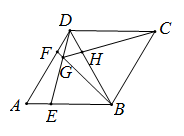

# Mathematics - 题目 847

**ID**: b70931f48e2242ea852cba28ed3226ca
**年级**: Grade 9
**难度**: Medium-Hard
**题型**: Fill-in-the-blank

## 题目
如图，在菱形 $ABCD$ 中， ${\tan}A=\sqrt {3}$ ，点 $E$ 、 $F$ 分别是 $AB$ 、 $AD$ 上任意的点（不与端点重合），且 $AE=DF$ ，连接 $BF$ 与 $DE$ 相交于点 $G$ ，连接 $CG$ 与 $BD$ 相交于点 $H$ ，给出如下几个结论：① $△AED≌△DFB$ ；​​​​​​​‌② $\angle BGE$ 的大小为定值；③ $\frac {GH}{DH}=\frac {BH}{BG}$ ；④若 $AF=2DF$ ，则 $BF=7GF$ ．其中正确结论的序号为．

## 解答

1. 解：①∵ABCD为菱形，
2. ∴AB=AD．
3. ∵ ${\tan}A=\sqrt {3}$ ，
4. ∴∠A=∠BCD==60°．
5. ∵AB=BD，
6. ∴△ABD为等边三角形，
7. ∴∠A=∠BDF=60°，AD=BD．
8. 在△AED和△DFB中，
9. $\begin{cases}AE=DF\\\angle A=\angle BDF\\AD=BD\end{cases}$ ，
10. ∴△AED≌△DFB，正确；
11. ②∵△AED≌△DFB，
12. ∴∠ADE=∠DBF，
13. ∴∠BGE=∠BDG+∠DBG=∠BDG+∠ADE=60°，正确．
14. ③∵∠BGE=60°，
15. ∴∠BGD =120°，
16. ∴∠BGD+∠BCD=180°，
17. ∴点B、C、D、G四点共圆，
18. ∴∠BCG=∠BDG，
19. ∵∠BHC=∠GHD，
20. ∴△GHD∽△BHC，
21. ∴ $\frac {GH}{DH}=\frac {BH}{CH}$ ，故③错误；
22. ④过点F作FP//AE于P点．
23. 
24. ∵AF=2FD，
25. ∴FP：AE=DF：DA=1：3，
26. ∵AE=DF，AB=AD，
27. ∴BE=AF，
28. ∴BE=2AE，
29. ∴FP：BE=1：6=FG：BG，
30. 即BG=6GF，
31. ∴BF=7GF，正确．
32. 综上所述，正确的结论有①②④．
33. 故答案为：①②④．

## 知识点

**中文**:
  - 特殊角的三角函数值
  - 菱形的性质
  - 相似三角形的判定与性质综合

**English**:
  - Trigonometric Values of Special Angles
  - Properties of Rhombuses
  - Determination and Properties

---
