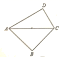

# Mathematics - 题目 149

**ID**: b7794dbc7e5947cba13bad63368b1097
**年级**: Grade 9
**难度**: Medium-Hard
**题型**: Fill-in-the-blank

## 题目
如图，四边形ABCD中，∠D=∠B=90°，AB=BC，CD=4，AC=8，设Q、R分别是AB、AD上的动点，则△CQR 的周长的最小值为．​​​​​​​‌

## 解答

1. 解：作C关于AB的对称点G，关于AD的对称点F，则三角形CQR的周长＝CQ＋QR＋CR＝GQ＋QR＋RF＝GF，
2. 
3. 在Rt△ADC中，∵sin∠DAC＝ $\frac {CD}{AC}=\frac {1}{2}$ ，
4. ∴∠DAC＝30°，
5. ∵BA＝BC，∠ABC＝90°，
6. ∴∠BAC＝∠BCA＝45°，
7. ∵∠ADC＝∠ABC＝90°，
8. ∴A，B，C，D四点共圆，
9. ∴∠CDB＝∠CAB＝45°，∠CBD＝∠CAD＝30°
10. 在三角形CBD中，作CH⊥BD于H，
11. BD＝DH＋BH＝4×cos45°＋ $4\sqrt {2}$ ×cos30°＝ $2\sqrt {2}+2\sqrt {6}$ ，
12. ∵CD＝DF，CB＝BG，
13. ∴GF＝2BD＝ $4\sqrt {2}+4\sqrt {6}$ ，
14. △CQR的周长的最小值为 $4\left ({\sqrt {2}+\sqrt {6}}\right )$ ．

## 知识点

**中文**:
  - 几何变换——轴对称综合题
  - 线段的性质：两点之间线段最短
  - 四边形综合

**English**:
  - Axial Symmetry Comprehensive Problems
  - Property of Line Segments
  - Comprehensive Quadrilateral Problems

---
