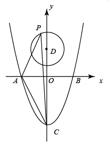

# Mathematics - 题目 1984

**ID**: b7c9f76038944836bdd61a4732ce32e6
**年级**: Grade 9
**难度**: Medium-Hard
**题型**: Fill-in-the-blank

## 题目
如图，二次函数 $y=x{^{2}}-4$ 与 $x$ 轴交于 $A､B$ 两点（点 $A$ 在点 $B$ 左边），与 $y$ 轴交于 $C$ 点，若点 $D$ 坐标为 $\left ({0,2}\right )$ ，以 $D$ 点为圆心， $\mathbf{R}$ 为半径作圆， $P$ 为 $\odot D$ 上一动点，当 $\mathrm{△}APC$ 面积最小为5时，则 $\mathbf{R}=$．​​​​​​​‌

## 解答

1. 过点D作DM⊥CA，交CA的延长线于点M，DM交 $\odot D$ 于点P，此时 $\mathrm{△}APC$ 面积最小，
2. 
3. ∵二次函数 $y=x{^{2}}-4$ 与 $x$ 轴交于 $A､B$ 两点（点 $A$ 在点 $B$ 左边），与 $y$ 轴交于 $C$ 点，
4. ∴A(-2，0)，C(0，-4)，即：OA=2，OC=4，AC= $\sqrt {2{^{2}}+4{^{2}}}=2\sqrt {5}$ ，
5. ∵点 $D$ 坐标为 $\left ({0,2}\right )$ ，
6. ∴OD=2，
7. ∵∠ACO=∠DCM，
8. ∴sin∠ACO=sin∠DCM，即： $\frac {OA}{AC}=\frac {DM}{CD}=\frac {2}{2\sqrt {5}}$ ，
9. ∴DM=CD× $\frac {2}{2\sqrt {5}}$ =6× $\frac {2}{2\sqrt {5}}$ = $\frac {6}{5}\sqrt {5}$ ．
10. ∵ $\mathrm{△}APC$ 面积最小值为5，
11. ∴ $\frac {1}{2}\cdot AC\cdot MP=\frac {1}{2}\times 2\sqrt {5}\times \left ({\frac {6}{5}\sqrt {5}-R}\right )=5$ ，解得：R= $\frac {\sqrt {5}}{5}$ ．
12. 故答案为： $\frac {\sqrt {5}}{5}$ ．

## 知识点

**中文**:
  - y=ax²的图象与性质
  - 圆的基本认识

**English**:
  - Graph and Properties of y=ax²
  - Basic Concepts of Circles

---
