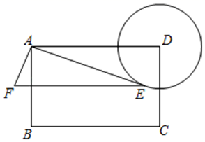

# Mathematics - 题目 797

**ID**: b81da04db32842b3b39ec41f397a2e79
**年级**: Grade 9
**难度**: Medium-Hard
**题型**: Fill-in-the-blank

## 题目
如图，矩形ABCD中，AB＝6，BC＝9，以D为圆心，3为半径作⊙D，E为⊙D上一动点，连接AE，以AE为直角边作Rt△AEF，使∠EAF＝90°，tan∠AEF＝ $\frac {1}{3}$  ，则点F与点C的最小距离为．​​​​​​​‌

## 解答

1. 如图，取AB的中点G，连接FG，
2. 
3. ∵AB=4，AD=6，
4. ∴AG=2， $\frac {AG}{AD}=\frac {2}{6}=\frac {1}{3}$ ；
5. 在Rt△AEF，∠EAF＝90°，tan∠AEF＝ $\frac {1}{3}$  ，
6. ∴ $\frac {AF}{AE}=\frac {1}{3}$ ,
7. ∴ $\frac {AF}{AE}=\frac {AG}{AD}=\frac {1}{3}$ ,
8. ∵∠EAF＝∠BAD＝90°，
9. ∴∠FAG＝∠EAD，
10. ∴△AFG∽△EAD，
11. ∴ $\frac {AF}{AE}=\frac {FG}{ED}=\frac {1}{3}$ ,
12. ∵DE=3,
13. ∴FG=1；
14. ∵点E为⊙D上一动点，
15. ∴点F在以点G为圆心，半径为1的圆上，
16. ∴当点F在线段GC上时，点F与点C的距离最小，
17. 在Rt△GBC中，BC=6，GB=3，由勾股定理求得GC=3 $\sqrt {10}$ ，
18. ∴FC=3 $\sqrt {10}$ ﹣1．
19. 即点F与点C的最小距离为3 $\sqrt {10}$ ﹣1．
20. 故答案为3 $\sqrt {10}$ ﹣1．

## 知识点

**中文**:
  - 最短路径问题
  - 相似三角形的判定与性质综合

**English**:
  - Shortest Path Problems
  - Determination and Properties

---
