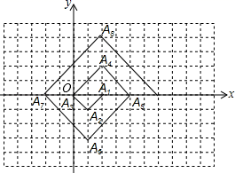

# Mathematics - 题目 481

**ID**: bbbc05572d4845339d0df7c911900c4e
**年级**: Grade 9
**难度**: Medium-Hard
**题型**: Fill-in-the-blank

## 题目
如图，在一单位为1的方格纸上，△A_{1}A_{2}A_{3}，△A_{3}A_{4}A_{5}，△A_{5}A_{6}A_{7}，…，都是斜边在x轴上、斜边长分别为2，4，6，…的等腰直角三角形．若△A_{1}A_{2}A_{3}的顶点坐标分别为A_{1}（2，0），A_{2}（1，﹣1），A_{3}（0，0），则依图中所示规律，A_{2019}的坐标为．​​​​​​​‌

## 解答

1. 解：∵各三角形都是等腰直角三角形，
2. ∴直角顶点的纵坐标的长度为斜边的一半，
3. A_{1}（2，0），A_{2}（1，﹣1），A_{3}（0，0），A_{4}（2，2），A_{5}（4，0），A_{6}（1，﹣3），A_{7}（﹣2，0），A_{8}（2，4），A_{9}（6，﹣1），A_{10}（1，﹣5），A_{11}（﹣4，0），A_{12}（2，6），…，
4. 由上可知，当脚码是1、5、19…时，横坐标是脚码加3和的一半，纵坐标为0；当脚码是2、6、10…时，横坐标为1，纵坐标为脚码的一半的相反数；当脚码是3、7、11…时，横坐标是脚码减3差的一半的相反数，纵坐标为0；当脚码是4、8、12…时，横坐标是2，纵坐标为脚码的一半．
5. ∵2019÷4＝504……3，
6. ∴点A_{2019}在x轴负半轴上，横坐标是﹣（2019﹣3）÷2＝﹣1008，纵坐标是0，
7. ∴A_{2019}的坐标为（﹣1008，0）．
8. 故答案为：（﹣1008，0）．

## 知识点

**中文**:
  - 点的坐标
  - 规律型：图形的变化类

**English**:
  - Coordinates of Points
  - Patterns: Geometric Variations

---
