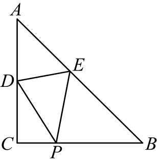

# Mathematics - 题目 1491

**ID**: bca359591c6a4bf887bf7c1ff2f95966
**年级**: Grade 9
**难度**: Medium-Hard
**题型**: Fill-in-the-blank

## 题目
如图，在等腰直角 $\vartriangle ABC$ 中， $\angle C=90\degree ,AC=8$ ，点 $D$ 是边 $AC$ 的中点，点 $P$ 是边 $BC$ 上一动点，连接 $PD$ ，将线段 $PD$ 绕点 $P$ 顺时针旋转，使点 $D$ 的对应点 $E$ 落在边 $AB$ 上，连接 $DE$ ，若 $\vartriangle ADE$ 为直角三角形，则 $CP$ 的长为．​​​​​​​‌

## 解答

1. 解： $\because $ 等腰直角 $\vartriangle ABC$ 中， $\angle C=90{}\degree $ ， $AC=BC=8$ ，
2. $\therefore ∠A=\angle B=45{}\degree $ ，则 $∠A$ 不为直角，
3. $\because \vartriangle ADE$ 为直角三角形，
4. $\therefore $ 可能的情况为 $\angle ADE=90{}\degree $ 或 $\angle AED=90{}\degree $ ，
5. 当 $\angle ADE=90{}\degree $ 时，
6. 过点 $E$ 作 $EF⊥BC$ 交 $BC$ 于点 $F$ ，如图，
7. 
8. $\because \angle ADE=\angle C=90{}\degree $ ，
9. $\therefore DE\mathrm{/\mskip-4mu/}BC$ ，
10. $\because $ 点 $D$ 是边 $AC$ 中点，
11. $\therefore DE$ 为 $\vartriangle ABC$ 中位线，
12. $\therefore DE=\frac {1}{2}BC=4$ ，
13. $\because \angle EFB=\angle C=90{}\degree $ ，
14. $\therefore DC/\mskip-4mu/EF$ ，
15. $\therefore $ 四边形 $DCFE$ 为平行四边形，
16. $\therefore CF=DE=4$ ，
17. 又 $\because \angle C=90{}\degree $ ，
18. $\therefore $ 四边形 $DCFE$ 为矩形，
19. $\therefore \angle CDE=\angle DEF=90{}\degree ,DC=EF$ ，
20. $\because $ 线段 $PD$ 旋转后得到 $PE$ ，
21. $\therefore PD=PE$ ，
22. $\therefore \angle PDE=\angle PED$ ，
23. $\therefore \angle CDE-\angle PDE=\angle DEF-\angle PED$ ，
24. $\therefore \angle CDP=\angle FEP$ ，
25. 在 $\vartriangle DCP$ 和 $△EFP$ 中，
26. $\begin{cases}DP=EP\\\angle CDP=\angle FEP\\DC=EF\end{cases}$ ，
27. $\therefore \vartriangle DCP≌\vartriangle EFP\left ({{\rm{S}}{\rm{A}}{\rm{S}}}\right )$ ，
28. $\therefore CP=FP$ ，
29. $\therefore CP=\frac {1}{2}CF=2$ ；
30. 若 $\angle AED=90{}\degree $ ，已求得 $\angle A=45{}\degree $ ， $\vartriangle ADE$ 是以点 $E$ 为直角顶点的等腰直角三角形，
31. $D$ 为边 $AC$ 的中点，
32. $\therefore AD=DC=\frac {1}{2}AC=4$ ，
33. 在 ${\rm{R}}{\rm{t}}\vartriangle ADE$ 中，
34. $\because \angle A=\angle ADE=45{}\degree $ ，
35. $\therefore AE=DE$ ，
36. $\therefore AE{^{2}}+DE{^{2}}=AD{^{2}}$ ，
37. $\therefore 2DE{^{2}}=AD{^{2}}$ ，即 $2DE{^{2}}=16$ ，
38. $\therefore DE=2\sqrt {2}$ ，或 $DE=-2\sqrt {2}$ （舍去），
39. 如图，
40. 
41. 过点 $P$ 作 $PH\bot DE$ ，交 $DE$ 于点 $H$ ，过点 $P$ 作 $PG\bot AB$ ，交 $AB$ 于点 $G$ ，
42. $\because DP=PE$ ，
43. $\therefore PH$ 是 $\vartriangle DEP$ 的中线，
44. $\therefore EH=\frac {1}{2}DE=\sqrt {2}$ ，
45. $\because \angle AED=\angle DEB=90{}\degree $ ， $\angle PGE=90{}\degree ,\angle PHE=90{}\degree $ ，
46. $\therefore $ 四边形 $PHEG$ 为矩形，
47. $\therefore PG=BG=\sqrt {2}$ ，
48. $\therefore PB=\sqrt {PG{^{2}}+BG{^{2}}}=\sqrt {2+2}=2$ ，
49. $\therefore CP=BC-BP=8-2=6$

## 知识点

**中文**:
  - 旋转的性质
  - 矩形的判定与性质综合
  - 等腰直角三角形的性质

**English**:
  - Properties of Rotation
  - Determination and Properties of Rectangles
  - Properties of Isosceles Right Triangles

---
