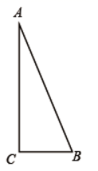

# Mathematics - 题目 2616

**ID**: be5a41176fe04e198ee16c65dd550a24
**年级**: Grade 9
**难度**: Medium-Hard
**题型**: Fill-in-the-blank

## 题目
已知点 $P$ 在 $ΔABC$ 内，联结 $PA$ 、 $PB$ 、 $PC$ ，在 $ΔPAB$ 、 $\Delta PBC$ 和 $ΔPAC$ 中，如果存在一个三角形与 $ΔABC$ 相似，那么就称点 $P$ 为 $ΔABC$ 的自相似点．如图，在 $Rt\Delta ABC$ 中， $\angle ACB=90{}^\circ $ ， $AC=12$ ， $BC=5$ ，如果点 $P$ 为 $Rt\Delta ABC$ 的自相似点，那么 $\angle ACP$ 的余切值等于．​​​​​​​‌

## 解答

1. ∵AC=12，BC=5，
2. ∴∠CAB<∠CBA，
3. 故可在∠CAB内作∠CBP=∠CAB，
4. 又∵点P为△ABC的自相似点，
5. ∴过点C作CP⊥PB，并延长CP交AB于点D，
6. 则△BPC∽△ACB，
7. ∴点P为△ABC的自相似点，
8. ∴∠BCP=∠CBA，
9. ∴∠ACP=∠BAC，
10. ∴∠ACP的余切 $\frac {AC}{BC}{\rm{=}}\frac {12}{5}$ ，
11. 故答案为： $\frac {12}{5}$ .
12. 

## 知识点

**中文**:
  - 相似三角形的性质

**English**:
  - Properties of Similar Triangles

---
