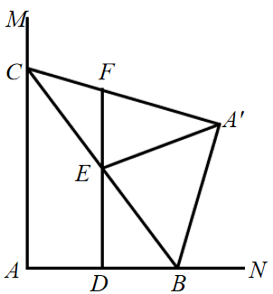

# Mathematics - 题目 586

**ID**: c53f694906924025a0621fbd12563a71
**年级**: Grade 9
**难度**: Medium-Hard
**题型**: Fill-in-the-blank

## 题目
如图， $\angle MAN=90{}^\circ $ ，点 $C$ 在边 $AM$ 上， $AC=2$ ，点 $B$ 为边 $AN$ 上一动点，连接 $BC$ ， $\vartriangle A^{′}BC$ 与 $\vartriangle ABC$ 关于 $BC$ 所在直线对称，点 $D$ ， $E$ 分别为 $AB$ ， $BC$ 的中点，连接 $DE$ 并延长交 $A^{′}C$ 所在直线于点 $F$ ，连接 $A^{′}E$ ．当 $\mathrm{△}A^{′}EF$ 为直角三角形时， $AB$ 的长为．​​​​​​​‌

## 解答

1. ∵ $\vartriangle A^{′}BC$ 与 $\vartriangle ABC$ 关于 $BC$ 所在直线对称，点D、E分别是AB、BC的中点，
2. ∴ $A^{′}C$ =AC，∠B $A^{′}$ C=∠A=90°， $A^{′}$ B=AB，DE是△ABC的中位线，
3. 当 $\mathrm{△}A^{′}EF$ 为直角三角形时，分情况讨论：
4. ①当∠ $A^{′}$ FE=90°时，如图所示，DF∥AC，∠A=90°，
5. ∴DF⊥AB，DF⊥ $A^{′}$ C，
6. ∴ $A^{′}$ C∥AB，
7. ∴∠AC $A^{′}$ =90°，即四边形AB $A^{′}$ C是矩形，
8. 又∵ $A^{′}$ B=AB，
9. ∴矩形AB $A^{′}$ C是正方形，
10. ∴AB=AC=2；
11. 
12. ②当∠ $A^{′}$ EF=90°时，如图所示，
13. ∵ $A^{′}$ E∥AB， $A^{′}$ E= $\frac {1}{2}$ BC，
14. ∴∠ $A^{′}$ EB=∠ABE=∠ $A^{′}$ BE，
15. ∴ $A^{′}$ E= $A^{′}$ B=BE，
16. ∴△ $A^{′}$ BE是等边三角形，∠ $A^{′}$ BE=60°，
17. ∵ $A^{′}$ C=AC=2，
18. ∴ $A^{′}$ B= $\frac {A^{′}C}{\sqrt {3}}$ = $\frac {2\sqrt {3}}{3}$ ，
19. ∴AB= $\frac {2\sqrt {3}}{3}$ ，
20. 综上所述，AB的长度为2或 $\frac {2\sqrt {3}}{3}$ ，
21. 故答案为：2或 $\frac {2\sqrt {3}}{3}$ ．
22. 

## 知识点

**中文**:
  - 直角三角形的性质
  - 等边三角形的判定与性质
  - 矩形的判定与性质综合
  - 轴对称的性质

**English**:
  - Properties of Right Triangles
  - Determination and Properties
  - Determination and Properties of Rectangles
  - Properties of Axial Symmetry

---
