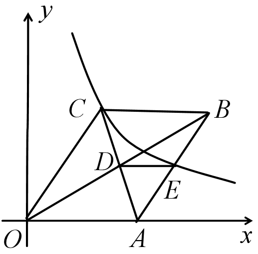

# Mathematics - 题目 437

**ID**: c5fc8780351f46338105b2f1990728f6
**年级**: Grade 9
**难度**: Medium-Hard
**题型**: Fill-in-the-blank

## 题目
如图在平面直角坐标系中， $▱OABC$ 的顶点 $A$ 在 $x$ 轴的正半轴上， $C$ 是第一象限内一点，对角线 $AC$ ， $OB$ 相交于点 $D$ ，反比例函数 $y=\frac {n}{x}$ 且的图象经过点 $C$ 和 $AB$ 边的中点 $E$ ，设 $\vartriangle ADE$ 的面积为 $m$ ，则 $n$ 关于 $m$ 的函数表达式为．​​​​​​​‌

## 解答

1. 
2. 如图所示，作 $EF\bot x$ 轴于F，延长BC交y轴于M，延长ED交OC于G，交y轴于H
3. ∵D为 $▱OABC$ 对角线交点
4. ∴ $AD=CD,OD=BD$
5. ∵E为AB中点
6. ∴DE为 $\vartriangle ABC$ 的中位线
7. ∴ $DE{\rm{/}}{\rm{/}}BC{\rm{/}}{\rm{/}}OA$
8. ∴ $EH\bot y$  轴于H， $BM\bot y$  轴于M
9. ∴同理可得：GD为 $\vartriangle COA$ 的中位线，HG为 $\vartriangle OMC$ 的中位线
10. ∴ $HG=\frac {1}{2}CM$
11. ∵四边形HOFE为矩形，四边形OAEG为平行四边形
12. ∴ $AF=OF-OA=HE-GE=HG=\frac {1}{2}CM$
13. 设A坐标为 $\left ({x{{}_{a}},y{{}_{a}}}\right )$  ，C坐标为 $\left ({x{{}_{c}},y{{}_{c}}}\right )$  ，则E点为 $\left ({2x{{}_{c}},\frac {1}{2}y{{}_{c}}}\right )$
14. ∵ $OF=OA+AF$
15. ∴ $2x{{}_{c}}=x{{}_{a}}+\frac {1}{2}x{{}_{c}}$
16. ∴ $x{{}_{a}}=\frac {3}{2}x{{}_{c}}$
17. ∵ $S{{}_{\mathrm{△}ADE}}=m$
18. 即 $S{{}_{\mathrm{△}ADE}}=\frac {1}{2}DE\times EF=\frac {1}{2}\times \frac {1}{2}OA\times EF=\frac {1}{2}\times \frac {1}{2}\times \frac {3}{2}x{{}_{c}}\times \frac {1}{2}y{{}_{c}}=m$
19. ∴ $n=x{{}_{c}}\times y{{}_{c}}=\frac {16}{3}m$
20. 故答案为： $n=\frac {16}{3}m$

## 知识点

**中文**:
  - 两组对边分别相等的四边形是平行四边形
  - 反比例函数综合
  - 矩形的性质

**English**:
  - Two Pairs of Equal Opposite Sides
  - Comprehensive Inverse Proportionality Problems
  - Properties of Rectangles

---
