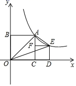

# Mathematics - 题目 1298

**ID**: cd78498fbc854b979e2046519d7cfb82
**年级**: Grade 9
**难度**: Medium-Hard
**题型**: Fill-in-the-blank

## 题目
如图，正方形 $ABOC$ 与正方形 $EFCD$ 的边 $OC$ 、 $CD$ 均在x轴上，点F在 $AC$ 边上，反比例函数 $y=\frac {k}{x}$ 的图象经过点A、E，且 $S{{}_{\vartriangle OAE}}=5$ ，则 $k=$．​​​​​​​‌

## 解答

1. 解：设A（a，a），E（a+b，b），
2. ∵反比例函数y＝ $\frac {k}{x}$ 的图象经过点A、E，且正方形ABOC与正方形EFCD的边OC、CD均在x轴上，
3. ∴S_{△}_{EOD}＝S_{△}_{AOC}＝ $\frac {1}{2}$ |k|，
4. ∴S_{梯形}_{ACDE}＝S_{△}_{AOE}+S_{△}_{EOD}﹣S_{△}_{AOC}＝S_{△}_{AOE}＝5，
5. ∴ $\frac {1}{2}$ （a+b）b＝5，
6. ∵S_{△}_{EOD}＝ $\frac {1}{2}$ （a+b）•b＝ $\frac {1}{2}$ |k|，
7. ∴5＝ $\frac {1}{2}$ |k|，
8. ∵反比例函数图象在第一象限，
9. ∴k＝10，
10. 故答案为10．

## 知识点

**中文**:
  - 反比例函数系数k的几何意义及应用

**English**:
  - Geometric Meaning and Application of Coefficient k

---
