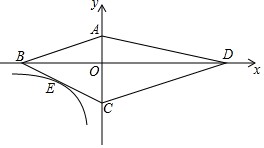

# Mathematics - 题目 2376

**ID**: cfcc134e4a4a48d8b1be7cd088c3960b
**年级**: Grade 9
**难度**: Medium-Hard
**题型**: Fill-in-the-blank

## 题目
如图，四边形ABCD的顶点都在坐标轴上，若AB∥CD， $\vartriangle $AOB与 $\vartriangle $COD面积分别为8和18，若双曲线y＝ $\frac {{\rm{k}}}{{\rm{x}}}$ 恰好经过BC的中点E，则k的值为．​​​​​​​‌

## 解答

1. 解：如图所示：
2. 
3. ∵AB∥CD，
4. ∴∠OAB＝∠OCD，∠OBA＝∠ODC，
5. ∴ $\vartriangle $OAB∽ $\vartriangle $OCD，
6. ∴ ${\rm \frac {OB}{OD}=\frac {OA}{OC}}$ ，
7. 若 ${\rm \frac {OB}{OD}=\frac {OA}{OC}}$ ＝m，
8. 由OB＝m•OD，OA＝m•OC，
9. 又∵ ${\rm S{{}_{△OAB}}=\frac {1}{2}\cdot OA\cdot OB}$ ， ${\rm S{{}_{△OCD}}=\frac {1}{2}\cdot OC\cdot OD}$ ，
10. ∴ ${\rm \frac {S{{}_{△OAB}}}{S{{}_{△OCD}}}=\frac {\frac {1}{2}OA\cdot OB}{\frac {1}{2}OC\cdot OD}=\frac {OA\cdot OB}{OC\cdot OD}}$ ＝ ${\rm \frac {m{^{2}}\cdot OC\cdot OD}{OC\cdot OD}=m{^{2}}}$ ，
11. 又∵S_{△}_{OAB}＝8，S_{△}_{OCD}＝18，
12. ∴ $m{^{2}}=\frac {8}{18}$ ，
13. 解得：m＝ $\frac {2}{3}$ 或m＝ $-\frac {2}{3}$  (舍去)，
14. 设点A、B的坐标分别为(0，a)，(b，0)，
15. ∵ ${\rm \frac {OA}{OC}=\frac {OB}{OD}=\frac {2}{3}}$ ，
16. ∴点C的坐标为(0，﹣ $\frac {3}{2}$a)，
17. 又∵点E是线段BC的中点，
18. ∴点E的坐标为( $\frac {b}{2},-\frac {3}{4}a$ )，
19. 又∵点E在反比例函数 $y=\frac {k}{x}(k>0)$ 上，
20. ∴ $k=\frac {b}{2}\cdot \left ({-\frac {3}{4}a}\right )$ ＝﹣ $\frac {3}{8}ab$ ＝ $-\frac {3}{8}\times (-16)=6$ ，
21. 故答案为：6．

## 知识点

**中文**:
  - 两直线平行内错角相等
  - 反比例函数系数k的几何意义及应用
  - 相似三角形的判定与性质综合
  - 线段的中点

**English**:
  - Parallel Lines have Equal Alternate Interior Angles
  - Geometric Meaning and Application of Coefficient k
  - Determination and Properties
  - Midpoint of a Line Segment

---
