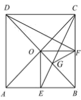

# Mathematics - 题目 2801

**ID**: d820201c42784eb3be25ad651952d8b6
**年级**: Grade 9
**难度**: Medium-Hard
**题型**: Fill-in-the-blank

## 题目
如图，在边长为1的正方形 $ABCD$ 中，对角线 $AC$ ， $BD$ 相交于点 $O$ ，点 $E$ ，点 $F$ 分别是 $AB$ ， $BC$ 的中点， $CE$ 交 $BD$ 于点 $G$ ，连接 $DF$ ， $OF$ ， $GF$ ，得到以下四个结论：① $CE\bot DF$ ，② $OC+OF=GC+GF$ ，③ $\angle BFG-\angle BDF=45^\circ $ ，④ $S{{}_{\vartriangle BFG}}=\frac {1}{12}$ ，其中正确的结论是（填写序号）．​​​​​​​‌

## 解答

1. ∵四边形ABCD是正方形
2. ∴ $CD=BC=AB，∠BCD=∠ABC=90{}^\circ $
3. ∵点 $E$ ，点 $F$ 分别是 $AB$ ， $BC$ 的中点
4. ∴ $EB=\frac {1}{2}AB，CF=\frac {1}{2}BC$
5. ∴ $EB=CF$
6. 在△DCF和△CBE中
7. $\begin{cases}CD=BC\\\angle BCD=\angle ABC\\CF=EB\end{cases}$
8. ∴ $△DCF≌△CBE$
9. ∴ $∠DFC=∠CEB$
10. ∴ $\begin{cases}\angle DFC=\angle CEB\\\angle BCE=\angle BCE\end{cases}$
11. ∴ $△CFH≌△CEB$
12. ∴ $∠CHF=∠CBE=90{}^\circ $
13. ∴ $CE\bot DF$ ，故①正确
14. 由勾股定理得
15. $AC=\sqrt {BC{^{2}}+AB{^{2}}}=\sqrt {1{^{2}}+1{^{2}}}=\sqrt {2}$
16. ∵四边形ABCD是正方形
17. ∴ $OC=\frac {1}{2}AC=\frac {\sqrt {2}}{2}$ ， $\angle ABD=\angle CBD$ ， $BD=AC$ ， $∠DBC=∠CAE=45{}^\circ $
18. ∵O是AC中点，F是BC中点
19. ∴ $OF=\frac {1}{2}AB=\frac {1}{2}$
20. ∴ $OC+OF=\frac {\sqrt {2}+1}{2}$
21. 在△BEG和△BFG中
22. $\begin{cases}BE=BF\\\angle ABD=\angle CBD\\BG=BG\end{cases}$
23. ∴ $△BEG≌△BFG$
24. ∴ $EG=FG$
25. ∴ $GC+GF=GC+EG=CE$
26. 由勾股定理得
27. $CE=\sqrt {BC{^{2}}+BE{^{2}}}=\sqrt {1{^{2}}+{\left({\frac {1}{2}}\right)^{2}}}=\frac {\sqrt {5}}{2}$
28. ∴ $GC+GF=\frac {\sqrt {5}}{2}$
29. ∴ $OC+OF\ne GC+GF$ ，故②错误
30. ∵ $△BEG≌△BFG$
31. ∴ $∠BEG=∠BFG$
32. 在△DBF和△CAE中
33. $\begin{cases}BD=AC\\\angle DBC=\angle CAE\\AE=BF\end{cases}$
34. ∴ $△DBF≌△CAE$
35. ∴ $∠BDF=∠CAE$
36. 根据三角形外角的性质可得
37. $∠CAB+∠CAE=∠CEB$
38. ∴ $45{}^\circ {\rm{+}}∠BDF=∠BFG$
39. ∴ $\angle BFG-\angle BDF=45^\circ $ ，故③正确
40. 作 $GI\bot BC$ 与BC交于I
41. ∵ $GI\bot BC$
42. ∴ $∠GIB=90{}^\circ $
43. ∵ $∠GBI=45{}^\circ $
44. ∴ $GI=BI$
45. 在△CGI和△CEB中
46. $\begin{cases}\angle GIC=\angle ABC\\\angle ECB=\angle ECB\end{cases}$
47. ∴ $△CGI∽△CEB$
48. ∴ $\frac {GI}{EB}=\frac {CI}{BC}$
49. ∴ $\frac {GI}{\frac {1}{2}}=\frac {1-GI}{1}$
50. 解得 $GI=\frac {1}{3}$
51. ∴ $S{{}_{\mathrm{△}BFG}}=\frac {1}{2}\times BF\times GI=\frac {1}{2}\times \frac {1}{2}\times \frac {1}{3}=\frac {1}{12}$ ，故④正确
52. 综上所述：①③④正确．
53. 故答案为：①③④．
54. 

## 知识点

**中文**:
  - 全等三角形实际应用
  - 勾股定理
  - 相似三角形的判定与性质综合

**English**:
  - Applications of Congruent Triangles
  - Pythagorean Theorem
  - Determination and Properties

---
