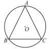

# Mathematics - 题目 1601

**ID**: d96e24faec7541dba3ebf245e7e9ca20
**年级**: Grade 9
**难度**: Medium-Hard
**题型**: Fill-in-the-blank

## 题目
如图，在△ABC 中，AB=AC，BC=8.​​​​​​​‌  $\odot {\rm{O}}$ 是△ABC的外接圆，其半径为5. 若点A在优弧BC上，则 ${\rm{t}}{\rm{a}}{\rm{n}}∠{\rm{A}}{\rm{B}}{\rm{C}}$ 的值为.

## 解答

1. 如图，作AD⊥BC，垂足为D，连接OB，
2. ∵AB=AC，∴BD=CD= $\frac {1}{2}$ BC= $\frac {1}{2}$ ×8=4，
3. ∴AD垂直平分BC，
4. ∴AD过圆心O，
5. 在Rt△OBD中，OD= $\sqrt {OB{^{2}}-BD{^{2}}}=\sqrt {5{^{2}}-4{^{2}}}$ =3，
6. ∴AD=AO+OD=8，
7. 在Rt△ABD中，tan∠ABC= $\frac {AD}{BD}=\frac {8}{4}$ =2，
8. 故答案为2.
9. 

## 知识点

**中文**:
  - 垂径定理的应用

**English**:
  - Applications of Perpendicular Chord Theorem

---
