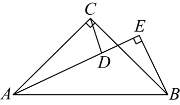

# Mathematics - 题目 2754

**ID**: dbdc4c1f0d6c4c579c5c639deb4c88ae
**年级**: Grade 9
**难度**: Medium-Hard
**题型**: Fill-in-the-blank

## 题目
如图，在 ${\rm{R}}{\rm{t}}\mathrm{△}ABC$ 中， $\angle ACB=90{}\degree ，CA=CB=3$ ，线段 $CD$ 绕点C在平面内旋转，过点B作 $AD$ 的垂线，交射线 $AD$ 于点E．若 $CD=1$ ，则 $AE$ 的取值范围是．​​​​​​​‌

## 解答

1. 解：∵ $\angle ACB\mathrm{=}90{}\degree $ ， $CA=CB=3$ ，
2. ∴ $\angle BAC=\angle ABC=\frac {1}{2}\times 90{}\degree =45{}\degree $ ，
3. ∵线段 $CD$ 绕点C在平面内旋转， $CD=1$ ，
4. ∴点D在以点C为圆心，1为半径的圆上，
5. ∵ $BE\mathrm{⊥}AE$ ，
6. ∴ $\angle AEB=90{}\degree $ ，
7. ∴点E在以 $AB$ 为直径的圆上，
8. 在 ${\rm{R}}{\rm{t}}△ABE$ 中， $AE=AB\cdot {\cos}\angle BAE$ ，
9. ∵ $AB$ 为定值，
10. ∴当 ${\cos}\angle BAE$ 最大时， $AE$ 最大， ${\cos}\angle BAE$ 最小时， $AE$ 最小，
11. ∴当 $AE$ 与 $\odot C$ 相切于点D，且点D在 $\vartriangle ABC$ 内部时， $∠BAE$ 最小， $AE$ 最大，连接 $CD$ ， $CE$ ，如图所示：
12. 
13. 则 $CD\bot AE$ ，
14. ∴ $\angle ADC=\angle CDE=90{}\degree $ ，
15. ∴ $AD=\sqrt {AC{^{2}}-CD{^{2}}}=\sqrt {3{^{2}}-1{^{2}}}=2\sqrt {2}$ ，
16. ∵ $∠CED=∠ABC=45{}\degree $ ， $\angle CDE=90{}\degree $ ，
17. ∴ $\vartriangle CDE$ 为等腰直角三角形，
18. ∴ $DE=CD=1$ ，
19. ∴ $AE=AD+DE=2\sqrt {2}+1$ ，
20. 即 $AE$ 的最大值为 $2\sqrt {2}+1$ ；
21. 当 $AE$ 与 $\odot C$ 相切于点D，且点D在 $\vartriangle ABC$ 外部时， $∠BAE$ 最大， $AE$ 最小，连接 $CD$ ， $CE$ ，如图所示：
22. 
23. 则 $CD\bot AE$ ，
24. ∴ $\angle CDE=90{}\degree $ ，
25. ∴ $AD=\sqrt {AC{^{2}}-CD{^{2}}}=\sqrt {3{^{2}}-1{^{2}}}=2\sqrt {2}$ ，
26. ∵四边形 $ABCE$ 为圆内接四边形，
27. ∴ $∠CEA=180{}\degree -∠ABC=135{}\degree $ ，
28. ∴ $∠CED=180{}\degree -∠CEA=45{}\degree $ ，
29. ∵ $\angle CDE=90{}\degree $ ，
30. ∴ $\vartriangle CDE$ 为等腰直角三角形，
31. ∴ $DE=CD=1$ ，
32. ∴ $AE=AD-DE=2\sqrt {2}-1$ ，
33. 即 $AE$ 的最小值为 $2\sqrt {2}-1$

## 知识点

**中文**:
  - 圆内接四边形
  - 圆周角定理及推论
  - 解直角三角形

**English**:
  - Cyclic Quadrilaterals
  - Inscribed Angle Theorem
  - Solving Right Triangles

---
