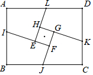

# Mathematics - 题目 1117

**ID**: dc96d88199664184939bdac7c9985627
**年级**: Grade 9
**难度**: Medium-Hard
**题型**: Fill-in-the-blank

## 题目
如图，矩形ABCD和正方形EFGH的中心重合， $AB=12$ ， $BC=16$ ， $EF=\sqrt {10}.​​​​​​​‌$ 分别延长FE，GF，HG和EH交AB，BC，CD，AD于点I，J，K， $L.$ 若 ${\rm{t}}{\rm{a}}{\rm{n}}\angle ALE=3$ ，则AI的长为，四边形AIEL的面积为．

## 解答

1. 解：延长LE交BC于M，延长JG交AD于T，延长KH交AB于R，延长IF交CD于W，作 $MN\bot AD$ 于N， $LZ\bot JT$ 于Z， $WS\bot AB$ 于S， $IQ\bot KR$ 于Q．
2. 
3. $\because $ 矩形ABCD和正方形EFGH的中心重合，
4. $\therefore $ 根据对称性可知： $BM=DT$ ， $AL=CJ$ ， $AR=CW$ ， $BI=DK$ ，
5. $\because $ 四边形ABMN，四边形BCWS，四边形EHQI，四边形GHLZ都是矩形，
6. $\therefore BM=AN=DT$ ， $CW=BS=AR$ ，
7. 由题意：在 $Rt\vartriangle SWI$ 中， ${\rm{t}}{\rm{a}}{\rm{n}}\angle WIS=\frac {SW}{IS}=3$ ，
8. $\therefore IS=\frac {16}{3}$ ， $IW=\frac {16\sqrt {10}}{3}$ ，
9. 在 $Rt\vartriangle RIQ$ 中， $IQ=EH=\sqrt {10}$ ， ${\rm{t}}{\rm{a}}{\rm{n}}\angle IRQ=3$ ，
10. $\therefore RQ=\frac {\sqrt {10}}{3}$ ， $RI=\frac {10}{3}$ ，
11. $\therefore AR=SB=\left ({12-\frac {16}{3}-\frac {10}{3}}\right )\div 2=\frac {5}{3}$ ，
12. $\therefore AI=\frac {10}{3}+\frac {5}{3}=5$ ， $IE=QH=GK=\left ({\frac {16\sqrt {10}}{3}-\frac {\sqrt {10}}{3}}\right )\div 2=\frac {5\sqrt {10}}{2}$ ，
13. 同法可得 $AL=\frac {25}{3}$ ， $LH=ZG=FJ=\left ({4\sqrt {10}-\frac {\sqrt {10}}{3}}\right )\div 2=\frac {11\sqrt {10}}{6}$ ， $EL=\frac {17\sqrt {10}}{6}$ ，
14. $\therefore $ 四边形AIEL的面积为 $=\frac {1}{2}\times 5\times \frac {25}{3}+\frac {1}{2}\times \frac {5\sqrt {10}}{2}\times \frac {17\sqrt {10}}{6}=\frac {675}{12}$

## 知识点

**中文**:
  - 正方形的性质
  - 矩形的性质
  - 解直角三角形

**English**:
  - Properties of Squares
  - Properties of Rectangles
  - Solving Right Triangles

---
