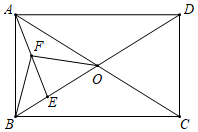

# Mathematics - 题目 973

**ID**: ed61d3e5a24747539b69947dcac61879
**年级**: Grade 9
**难度**: Medium-Hard
**题型**: Fill-in-the-blank

## 题目
如图，矩形ABCD中， $AB=4$ ，对角线AC，BD交于点O， $\angle AOD=120{}^\circ $ ，E为BD上任意一点，F为AE的中点，则 $FB+FO$ 的最小值为．​​​​​​​‌

## 解答

1. 解：过 $AB$ 的中点 $M$ 和 $AD$ 的中点 $N$ 作直线 $MN$ ，
2. $\because F$ 为 $AE$ 的中点，
3. $\therefore MF//BE$ ， $FN//ED$ ，
4. $\therefore M$ 、 $F$ 、 $N$ 三点共线，即 $F$ 点在线段 $MN$ 上，
5. 作 $B$ 关于 $MN$ 的对称点 $H$ ， $BH$ 与 $MN$ 交于点 $G$ ，连接 $OH$ ， $OH$ 与 $MN$ 交于点 $F$ ，
6. 则 $BF=HF$ ，
7. 此时， $BF+OF=HF+OF=OH$ ，其值为最小值．
8. $\because \angle AOD=120{}^\circ $ ，
9. $\therefore \angle AOB=60{}^\circ $ ，
10. $\because $ 四边形 $ABCD$ 为矩形，
11. $\therefore OA=OB$ ，
12. $\therefore ΔOAB$ 为等边三角形，
13. $\therefore OB=AB=4$ ， $\angle ABO=60{}^\circ $ ，
14. $\because MF//BE$ ，
15. $\therefore \angle GMB=\angle MBE=60{}^\circ $ ，
16. $\therefore GH=BG=BM\centerdot {\sin}60{}^\circ =\frac {1}{2}AB\centerdot {\sin}60{}^\circ =\sqrt {3}$ ， $\angle HBM=30{}^\circ $ ，
17. $\therefore BH=2\sqrt {3}$ ， $\angle HBO=90\mathrm{°}$ ，
18. $\therefore OH=\sqrt {BH{^{2}}+OB{^{2}}}=2\sqrt {7}$ ，
19. 故答案为： $2\sqrt {7}$ ．
20. 

## 知识点

**中文**:
  - 矩形的性质
  - 等边三角形的判定与性质
  - 轴对称的性质
  - 解直角三角形

**English**:
  - Properties of Rectangles
  - Determination and Properties
  - Properties of Axial Symmetry
  - Solving Right Triangles

---
