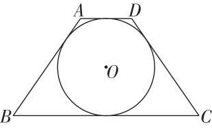

# Mathematics - 题目 2270

**ID**: ed91d42ba55f4ac18ce19175198607d2
**年级**: Grade 9
**难度**: Medium-Hard
**题型**: 填空题（本大题共4个小题，每小题3分，共12分）

## 题目
如图，梯形 $ABCD$ 中， $AD//BC$ , $AB=CD=10$ ， $\odot O$ 与梯形 $ABCD$ 的各边都相切，且 $\odot O$ 的面积为 $16\mathrm{\pi }$  ，则点 $B$ 到 $CD$ 的距离为.​​​​​​​‌

## 解答

1. 如图，将边 $AD$ , $CD$ , $BC$ 与 $\odot O$ 的切点分别记为点 $E$ , $F$ , $G$ ，连接 $OE$ , $OG$ , $OF$ ，过点 $D$ 作 $DH\perp BC$ 于点 $H$ ，过点 $B$ 作 $BK\perp CD$ 于点 $K$ ，过点 $A$ 作 $AM\perp BC$ 于点 $M$ ， $\therefore OE\perp AD$ , $OF\perp CD$ , $OG\perp BC$ ， $DE=DF$ , $CF=CG$ ， $\therefore \mathrm{\angle }OGC=\mathrm{\angle }OED=\mathrm{\angle }DHG=\mathrm{\angle }DHC=\mathrm{\angle }BKC={90}^{\circ }.\because AD//BC$ ， $\therefore $  点 $E$ , $O$ , $G$ 共线， $\therefore $  四边形 $EGHD$ 为矩形， $\therefore EG=DH$ , $DE=HG.\because \odot O$ 的面积为 $16\mathrm{\pi }$  ， $\therefore \mathrm{\pi }O{E}^{2}=16\mathrm{\pi }$  ， $\therefore OE=4$ ， $\therefore EG=2OE=8=DH$ .设 $DE=DF=HG=x.\because CD=10$ ， $\therefore CF=CG=10-x$ ， $\therefore CH=CG-HG=10-2x.\because $  在 $\mathrm{R}\mathrm{t}△DHC$ 中， $D{H}^{2}+H{C}^{2}=D{C}^{2}$ ， $\therefore {8}^{2}+(10-2x)^{2}={10}^{2}$ ，解得 $x=2$ 或 $x=8$ （舍去）， $\therefore CH=10-2×2=6$ .同理可得 $AE=MG=2$ ， $BM=6$ ， $\therefore BC=BM+MG+GH+CH=6+2+2+6=16.\because \mathrm{\angle }C=\mathrm{\angle }C$ , $\mathrm{\angle }BKC=\mathrm{\angle }DHC={90}^{\circ }$  ， $\therefore △BKC\sim △DHC$ ， $\therefore \frac{BK}{DH}=\frac{BC}{DC}$ ， $\therefore \frac{BK}{8}=\frac{16}{10}$ ， $\therefore BK=\frac{64}{5}$ ， $\therefore $  点 $B$ 到 $CD$ 的距离为 $\frac{64}{5}$ ，故答案为 $\frac{64}{5}$ .
2. 

## 知识点

**中文**:
  - 切线长定理
  - 矩形的判定与性质综合
  - 相似三角形的判定与性质综合

**English**:
  - Tangent Length Theorem
  - Determination and Properties of Rectangles
  - Determination and Properties

---
