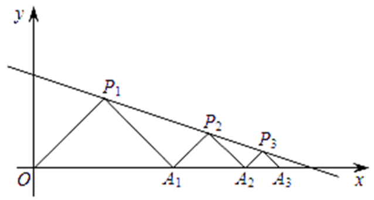

# Mathematics - 题目 2737

**ID**: ede8c53a899d4de18cf1b066d3dd5a4e
**年级**: Grade 9
**难度**: Medium-Hard
**题型**: Fill-in-the-blank

## 题目
如图，在平面直角坐标系中， $\Delta P{{}_{1}}OA{{}_{1}}$ ， $\Delta P{{}_{2}}A{{}_{1}}A{{}_{2}}$ ， $\Delta P{{}_{3}}A{{}_{2}}A{{}_{3}}$  ，．．．都是等腰直角三角形，其直角顶点 $P{{}_{1}}\left ({3,3}\right )$ ， $P{{}_{2}}$ ， $P{{}_{3}}$ ，．．．均在直线 $y=-\frac {1}{3}x+4$ 上，设 $\Delta P{{}_{1}}OA{{}_{1}}$ ， $\Delta P{{}_{2}}A{{}_{1}}A{{}_{2}}$ ， $\Delta P{{}_{3}}A{{}_{2}}A{{}_{3}}$ ，．．．的面积分别为 $S{{}_{1}}$ ， $S{{}_{2}}$ ， $S{{}_{3}}$ ，．．．，依据图形所反映的规律，S_{2020}＝．​​​​​​​‌

## 解答

1. 如图，分别过点 $P{{}_{1}}$ 、 $P{{}_{2}}$ 、 $P{{}_{3}}$ 作x轴的垂线段，垂足分别为C，D ，E． P(3,3)，且 $\Delta P{{}_{1}}OA{{}_{1}}$ ，是等腰直角三角形，
2. ∴OC=C $A{{}_{1}}$ = $P{{}_{1}}$ C=3，则 $P{{}_{2}}$ D=a，
3. ∴OD=6+a，
4. ∴点 $P{{}_{2}}$ 的坐标为(6+a，a) a.
5. 将点 $P{{}_{2}}$ 的坐标代入 $y=-\frac {1}{3}x+4$ 中，得− $\frac {1}{3}$  (6+a)+4=a，解得a= $\frac {3}{2}$
6. ∴ $A{{}_{1}}A{{}_{2}}$ =2a=3， $P{{}_{2}}$ D= $\frac {3}{2}$  ．
7. 同理求得 $P{{}_{3}}E$  = $\frac {3}{4}$  ， $A{{}_{2}}A{{}_{3}}$  = $\frac {3}{2}$  ．
8. ∵ $S{{}_{1}}$ = $\frac {1}{2}$  ×6×3=9， $S{{}_{2}}$ = $\frac {1}{2}$ ×3× $\frac {3}{2}$  = $\frac {9}{4}$ ，
9. $S{{}_{3}}$ = $\frac {1}{2}$ × $\frac {3}{2}$ × $\frac {3}{4}$ = $\frac {9}{16}$ ，…，∴ $S{{}_{2020}}$ = $4{^{\frac {9}{2019}}}$
10. 

## 知识点

**中文**:
  - 点的坐标
  - 规律型：图形的变化类
  - 等腰三角形的性质

**English**:
  - Coordinates of Points
  - Patterns: Geometric Variations
  - Properties of Isosceles Triangles

---
