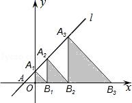

# Mathematics - 题目 2965

**ID**: ee0583c06b6b4e4aaf0ee72917d3cfa7
**年级**: Grade 9
**难度**: Medium-Hard
**题型**: Fill-in-the-blank

## 题目
如图，在平面直角坐标系中，直线l：y=x+2交x轴于点A，交y轴于点A_{1}，点A_{2}，A_{3}，…在直线l上，点B_{1}，B_{2}，B_{3}，…在x轴的正半轴上，若△A_{1}OB_{1}，△A_{2}B_{1}B_{2}，△A_{3}B_{2}B_{3}，…，依次均为等腰直角三角形，直角顶点都在x轴上，则第n个等腰直角三角形A_{n}B_{n}_{﹣}_{1}B_{n}顶点B_{n}的横坐标为．​​​​​​​‌

## 解答

1. 由题意得OA=OA_{1}=2，
2. ∴OB_{1}=OA_{1}=2，B_{1}B_{2}=B_{1}A_{2}=4，B_{2}A_{3}=B_{2}B_{3}=8，
3. ∴B_{1}（2，0），B_{2}（6，0），B_{3}（14，0）…，
4. 2=2^{2}﹣2，6=2^{3}﹣2，14=2^{4}﹣2，…
5. ∴B_{n}的横坐标为 $2{^{n+1}}-2$ ，
6. 故答案为： $2{^{n+1}}-2$ ．

## 知识点

**中文**:
  - 等腰三角形的判定与性质
  - 规律型：图形的变化类

**English**:
  - Determination and Properties
  - Patterns: Geometric Variations

---
