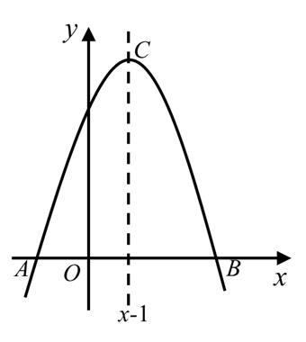

# Mathematics - 题目 3289

**ID**: fcf5534677e84cc791171c7528e2d808
**年级**: Grade 9
**难度**: Medium-Hard
**题型**: Fill-in-the-blank

## 题目
如图，抛物线 $y=ax{^{2}}+bx+c(a\ne 0)$ 与x轴交于点A、B，顶点为C，对称轴为直线 $x=1$ ，给出下列结论：① $abc<0$ ；​​​​​​​‌②若点C的坐标为 $\left ({1,2}\right )$ ，则 $\vartriangle ABC$ 的面积可以等于2；③ $M\left ({x{{}_{1}},y{{}_{1}}}\right ),\\\N\left ({x{{}_{2}},y{{}_{2}}}\right )$ 是抛物线上两点 $\left ({x{{}_{1}}<x{{}_{2}}}\right )$ ，若 $x{{}_{1}}+x{{}_{2}}>2$ ，则 $y{{}_{1}}<y{{}_{2}}$ ；④若抛物线经过点 $(3,-1)$ ，则方程 $ax{^{2}}+bx+c+1=0$ 的两根为 $-1$ ，3其中正确结论的序号为．

## 解答

1. 解：① $\because $  开口向下， $\therefore $  a<0， $\because $  对称轴x=1,a<0, $\therefore $  b>0， $\because $ 抛物线与y轴的交点在y的正半轴上， $\therefore $  c>0， abc<0，正确．
2. ②从图像可知，AB>4, $S{{}_{ΔABC}}=\frac {1}{2}\times AB\times C{{}_{y}}$ > $\frac {1}{2}\times 4\times 2$ ， $\therefore S{{}_{ΔABC}}>2$  ，故错误．
3. ③ $\because $   $x{{}_{1}}+x{{}_{2}}>2$ ， $\therefore $ 从图像可知  $x{{}_{1}}$  到1的距离小于 $x{{}_{2}}$  到1的距离，从图像可知，越靠近对称轴，函数值越大； $\therefore y{{}_{1}}>y{{}_{2}}$  ，故错误．
4. ④把点（3，-1）代入抛物线得 $9a+3b+c=-1$  ，即 $ax{^{2}}+bx+c=-1$  ，∴ $ax{^{2}}+bx+c+1=0$ ，即x=3，是方程 $ax{^{2}}+bx+c+1=0$ 的解，根据抛物线的对称性，所以另一解为-1，故正确．

## 知识点

**中文**:
  - 二次函数的图象与系数之间的关系
  - 二次函数的图象和性质

**English**:
  - Relationship between Graphs and Coefficients
  - Graphs and Properties of Quadratic Functions

---
