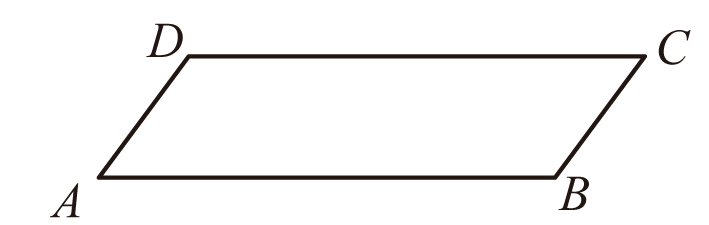

# Mathematics - 题目 3750

**ID**: fe7841db32024812a60bc5485aee0796
**年级**: Grade 9
**难度**: Medium-Hard
**题型**: Fill-in-the-blank

## 题目
如图， $▱ABCD$ 中， $\angle DAB=45{}^\circ $ ， $AB=8$ ， $BC=3$ ，P为边 $CD$ 上一动点，则 $PB+\frac {\sqrt {2}}{2}PD$ 的最小值等于．​​​​​​​‌

## 解答

1. 解：如图，过点P作PE⊥AD，交AD的延长线于点E，
2. 
3. ∵ $AB{\rm{/\mskip-4mu/}}CD$ ，
4. ∴∠EDP=∠DAB=45°，
5. ∴ ${\sin}\angle EDP=\frac {EP}{DP}=\frac {\sqrt {2}}{2}$ ，
6. ∴ $EP=\frac {\sqrt {2}}{2}PD$ ，
7. ∴ $PB+\frac {\sqrt {2}}{2}PD=PB+PE$ ，
8. ∴当点B，点P，点E三点共线且BE⊥AD时，PB+PE有最小值，即最小值为BE，
9. ∵ ${\sin}\angle A=\frac {BE}{AB}=\frac {\sqrt {2}}{2}$ ，
10. ∴ $BE=\frac {\sqrt {2}}{2}AB{\rm{=}}\frac {\sqrt {2}}{2}\times 8{\rm{=}}4\sqrt {2}$ ，
11. 故答案为： $4\sqrt {2}$ ．

## 知识点

**中文**:
  - 垂线段最短
  - 平行四边形的对边平行且相等
  - 解直角三角形

**English**:
  - Shortest Perpendicular Segment
  - Opposite Sides Parallel and Equal
  - Solving Right Triangles

---
