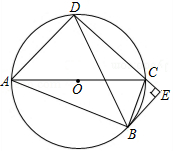

# Mathematics - 题目 2654

**ID**: 6c0d0029ae204fe9b93191948ed913e6
**年级**: Grade 9
**难度**: Medium-Hard
**题型**: 23题各10分，共29分）

## 题目
如图， $\odot O$ 是 $ΔABC$ 的外接圆， $AC$ 是直径，弦 $BD=BA$ ， $EB\bot DC$ ，交 $DC$ 的延长线于点 $E$ ．（1）求证： $BE$ 是 $\odot O$ 的切线；​​​​​​​‌（2）当 ${\sin}\angle BCE=\frac {3}{4}$ ， $AB=3$ 时，求 $AD$ 的长．

## 解答

1. 解：（1）证明：连接 $OB$ ， $OD$ ，
2. 在 $ΔABO$ 和 $ΔDBO$ 中， $\begin{cases}AB=BD\\BO=BO\\OA=OD\end{cases}$ ，
3. $\therefore ΔABO\cong ΔDBO(SSS)$ ，
4. $\therefore \angle DBO=\angle ABO$ ，
5. $\because \angle ABO=\angle OAB=\angle BDC$ ，
6. $\therefore \angle DBO=\angle BDC$ ，
7. $\therefore OB//ED$ ，
8. $\because BE\bot ED$ ，
9. $\therefore EB\bot BO$ ，
10. $\therefore BE$ 是 $\odot O$ 的切线；
11. （2）连接 $BO$ 并延长交 $AD$ 于点 $F$ ，
12. $\because AB=BD$ ，
13. $\therefore BF\bot AD$ ，
14. $\because \angle BAF=\angle BCE$ ，
15. $\therefore {\sin}\angle BAF={\sin}\angle BCE=\frac {3}{4}$ ，
16. $\because AB=3$ ，
17. $\therefore BF=\frac {9}{4}$ ，
18. $\therefore AF=\sqrt {AB{^{2}}-BF{^{2}}}=\frac {3\sqrt {7}}{4}$ ，
19. $\therefore AD=2AF=\frac {3\sqrt {7}}{2}$ ．
20. 
21. 【点评】本题考查了圆的切线性质与判定，全等三角形的性质与判定，锐角三角函数的定义等知识，综合程度较高，需要学生综合运用知识．延长 $BO$ 交 $AD$ 于点 $F$ ，

## 知识点

**中文**:
  - 三角形的外接圆
  - 切线的判定定理
  - 圆的综合问题

**English**:
  - Circumcircle of Triangle
  - Tangent Determination Theorem
  - Comprehensive Circle Problems

---
