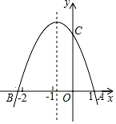

# Mathematics - 题目 2296

**ID**: 0075d79cb149473a90788e925fb9e6df
**年级**: Grade 9
**难度**: Medium-Hard
**题型**: Multiple-choice

## 题目
如图所示，抛物线y＝ax^{2}+bx+c（a≠0）与x轴交于点A(1，0)和点B，与y轴的正半轴交于点C．现有下列结论：①abc＞0；​​​​​​​‌②4a﹣2b+c＞0；③2a﹣b＞0；④3a+c＝0，其中，正确结论的个数是（      ）

## 解答

1. 解：①∵抛物线的开口向下，
2. ∴a＜0，
3. ∵对称轴位于y轴的左侧，
4. ∴a、b同号，即ab＞0，
5. ∵抛物线与y轴交于正半轴，
6. ∴c＞0，
7. ∴abc＞0，
8. 故①正确；
9. ②如图，当x＝﹣2时，y＞0，即4a﹣2b+c＞0，
10. 故②正确；
11. ③对称轴为x＝﹣ $\frac {b}{2a}$ ＞﹣1，得2a＜b，即2a﹣b＜0，
12. 故③错误；
13. ④∵当x＝1时，y＝0，
14. ∴0＝a+b+c，
15. 又∵2a﹣b＜0，即b＞2a，
16. ∴0＝a+b+c＞a+2a+c＝3a+c，即3a+c＜0，
17. 故④错误．
18. 综上所述，①②正确，即有2个结论正确．
19. 故选：B．

## 知识点

**中文**:
  - 二次函数的图象与系数之间的关系

**English**:
  - Relationship between Graphs and Coefficients

---
