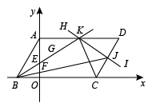

# Mathematics - 题目 1179

**ID**: 0b00e6608e734aa48ae341fb372b6d56
**年级**: Grade 9
**难度**: Medium-Hard
**题型**: Multiple-choice

## 题目
如图， $▱ABCD$ 的顶点A在平面直角坐标系的y轴上，且BC边在x轴上， $AB=2$ ，小丽尺规作图保留作图痕迹后，射线BG与直线HI恰交于AD边上中点K，则点J的坐标为（      ）​​​​​​​‌

## 解答

1. 解：如图所示，过J作JM⊥x轴，由尺规作图可知，BK平分∠ABC，HI是CD的垂直平分线，则∠ABK=∠CBK= $\frac {1}{2}\angle ABC$ ，KC=KD，K是AD的中点，
2. 
3. ∴AK=DK= $\frac {1}{2}AD$ ，
4. ∵四边形ABCD为平行四边形，
5. ∴AB=DC，AB$/\mskip-4mu/$CD，AD=BC，
6. ∴∠AKB=∠CBK，
7. ∴∠AKB=∠ABK，
8. ∴AB=AK，
9. ∴AB=AK=DK=KC=DC，
10. ∴∆CDK是等边三角形，
11. ∴∠CKD=∠CDK=∠DCK=60°，
12. ∵AD$/\mskip-4mu/$CB，
13. ∴∠DCM=∠CDK=60°，
14. ∵AB$/\mskip-4mu/$DC，
15. ∴∠DCM=∠ABC=60°，
16. 在Rt∆OAB中，∠ABO=60°，AB=2，
17. ∴OB=AB∙ ${\cos}∠ABO=2\times \frac {1}{2}=1$ ，
18. OA=AB∙ ${\sin}∠ABO=2\times \frac {\sqrt {3}}{2}=\sqrt {3}$ ，
19. ∵JM⊥x轴于点M，
20. ∴∠JMC=∠AOB=90°，
21. ∵∠JMC=∠ABO，
22. ∴∆CMJ~∆BOA，
23. ∴ $\frac {CM}{BO}=\frac {CO}{BA}=\frac {MJ}{OA}$ ，
24. ∵HI是CD的垂直平分线交CD于点J，
25. ∴CJ=DJ= $\frac {1}{2}CD=\frac {1}{2}AB=1$ ，
26. ∴ $\frac {CM}{1}=\frac {1}{2}=\frac {MJ}{\sqrt {3}}$ ，AD=2AK=2AB=4，
27. ∴BC=AD=4，MJ= $\frac {\sqrt {3}}{2}$ ，
28. ∴OC=BC-OB=4-1=3，OM=OC+CM=3+ $\frac {1}{2}=\frac {7}{2}$ ，
29. ∴J( $\frac {7}{2},\frac {\sqrt {3}}{2}$ )，
30. 故选：B．

## 知识点

**中文**:
  - 坐标与图形性质
  - 平行四边形的对边平行且相等
  - 相似三角形的判定与性质综合
  - 解直角三角形

**English**:
  - Coordinates and Geometric Properties
  - Opposite Sides Parallel and Equal
  - Determination and Properties
  - Solving Right Triangles

---
